Архитектурный паттерн MVC (Model — View — Controller) предполагает разделение приложения на три функционально самостоятельных модуля.

**View (представление)** отвечает за пользовательский интерфейс: получает доступ к элементам DOM, создаёт и изменяет их, регистрирует обработчики событий, переданные контроллером, и отображает данные в соответствии с разметкой страницы.

**Model (модель)** отвечает за данные и бизнес-логику приложения: получает, хранит, изменяет, сортирует, фильтрует данные, производит необходимые вычисления и предоставляет результаты обработки, не заботясь о том, как они будут представлены пользователю.

**Controller (контроллер)** управляет взаимодействием модели и представления: определяет обработчики пользовательских действий, передаёт их представлению, вызывает необходимые методы модели для получения или изменения данных, а затем передаёт результаты представлению для обновления интерфейса.

В рассматриваемой архитектуре `main.js` служит точкой входа в приложение и инициирует работу контроллера. Контроллер использует модули `Model` и `View`, а модель обращается к модулю `data.js`, служащему источником исходных данных. Эти связи образуют граф зависимостей между модулями.

После первоначальной загрузки приложение работает по следующей схеме: пользователь взаимодействует с представлением, событие вызывает обработчик контроллера, контроллер обращается к модели, получает результат и передаёт его представлению для обновления интерфейса. Благодаря такому разделению обязанностей модель не зависит от устройства интерфейса, представление не занимается бизнес-логикой, а контроллер координирует их работу.

# **1\. Загрузка и запуск приложения**

В HTML-файле подключается `main.js` как JavaScript-модуль. Он служит входной точкой приложения (entry point).

```js
import { startController } from "./controller.js";

console.log("[MAIN] Запуск приложения MVC");
startController();
```

Однако браузер не сразу приступает к выполнению инструкций `console.log()` и `startController()`. Сначала необходимо *загрузить модули, от которых зависит `main.js`,* *в оперативную память компьютера, используемую браузером, установить связи* между ними и выполнить их *код верхнего уровня.*

Весь процесс состоит из трёх этапов:

* **Loading** — загрузка модулей.
* **Linking** — связывание модулей.
* **Evaluation** — выполнение модулей.

## **1.1. Загрузка модулей (Loading)**

Браузер анализирует исходный код `main.js` и обнаруживает инструкцию импорта:

```js
import { startController } from "./controller.js";
```

Браузер загружает файл `controller.js` в оперативную память. При анализе его исходного кода обнаруживаются инструкции импорта из двух других модулей:

```js
import {
    loadFighters,
    getRanks,
    getTotalCount,
    getVisibleFighters
} from "./model.js";

import {
    bindEvents,
    readFilters,
    renderRanks,
    renderFighters,
    renderCounter,
    showStatus,
    setLoading
} from "./view.js";
```

Браузер загружает `model.js` и `view.js`. В модуле `model.js` обнаруживается ещё одна инструкция импорта:

```js
import { fetchFighters } from "./data.js";
```

Браузер загружает `data.js`. Этот модуль не содержит инструкций импорта, поэтому цепочка зависимостей на нём заканчивается.

В результате образуется *граф зависимостей модулей* (module dependency graph) — структура, показывающая, какой модуль от какого зависит.

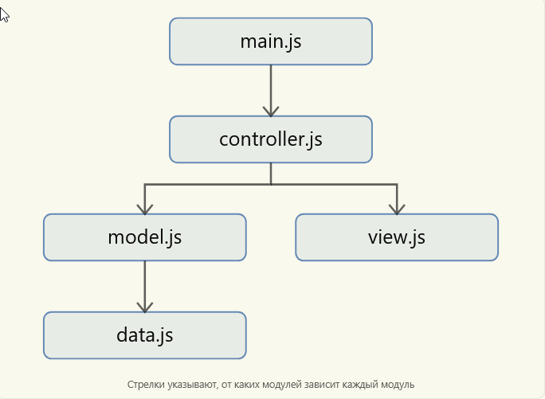

**Результат этапа Loading.** Все пять JavaScript-модулей загружены, их исходный код проанализирован, зависимости определены. Выполнение программных инструкций ещё не началось.

## **1.2. Связывание модулей (Linking)**

Движок JavaScript создаёт для каждого модуля собственную область видимости — окружение, в котором будут существовать его переменные, константы, функции и импортированные имена.

На этом этапе создаются объекты функций, объявленных через `function` и `async function`, резервируются привязки для переменных `let` и `const`, устанавливаются связи между импортируемыми и экспортируемыми сущностями. Тела функций ещё не выполняются, а переменные `let` и `const` не получают начальных значений.

> Движок JavaScript не просто регистрирует имена функций. Он создаёт в оперативной памяти полноценные объекты функций, содержащие сведения о программном коде, параметрах, лексическом окружении и механизме вызова.
> Благодаря этому функция существует как самостоятельная программная сущность ещё до своего первого вызова. Её можно передавать между модулями, сохранять под другими именами, регистрировать в качестве обработчика событий и вызывать впоследствии.
> Если бы функция представляла собой исключительно именованный участок программного кода, который можно вызвать, возможности работы с ней были бы ограничены. Представление функции в виде объекта позволяет обращаться с ней как со значением: присваивать переменным, передавать другим функциям, возвращать из функций, сохранять в массивах и свойствах других объектов.

На этапе **Linking** движок JavaScript создаёт в области видимости модуля запись о переменных с именами. Однако значения этим переменным ещё не присвоено. Такая запись, связывающая имя переменной с её будущим значением, называется **привязкой (binding)**.

Рассмотрим, что именно создаётся в каждом модуле нашего приложения.

### `data.js`

Создана одна функция:

* `fetchFighters` — получение данных из JSON-файла.

Переменных верхнего уровня нет.

### `model.js`

Созданы четыре функции:

* `loadFighters` — загрузка и сохранение данных о бойцах.
* `getRanks` — получение списка званий.
* `getTotalCount` — получение общего количества бойцов.
* `getVisibleFighters` — фильтрация и сортировка бойцов.

Зарегистрирована одна переменная `fighters` — будущий массив бойцов. Сам массив ещё не создан.

Установлена связь с импортированной из `data.js` функцией `fetchFighters`.

### `view.js`

Созданы семь функций:

* `readFilters` — чтение параметров фильтрации.
* `bindEvents` — регистрация обработчиков событий.
* `renderRanks` — заполнение списка званий.
* `renderFighters` — построение таблицы бойцов.
* `renderCounter` — отображение количества бойцов.
* `showStatus` — отображение состояния загрузки.
* `setLoading` — изменение состояния кнопки загрузки.

Зарегистрированы восемь констант:

* `tbody`
* `searchInput`
* `rankSelect`
* `sortSelect`
* `reloadButton`
* `counter`
* `status`
* `emptyMessage`

Значения этим константам ещё не присвоены. Вызовы `document.querySelector()` пока не выполнены.

### `controller.js`

Созданы три функции:

* `updateScreen` — обновление представления.
* `reloadData` — загрузка данных и обновление представления.
* `startController` — запуск контроллера.

Установлены связи с четырьмя импортированными функциями модели и семью импортированными функциями представления.

### `main.js`

Собственных переменных и функций нет. Установлена связь с импортированной из `controller.js` функцией `startController`.

### **Результат этапа Linking**

| Модуль | Создано функций | Зарегистрировано переменных и констант | Связей импорта |
| ------ | --------------- | -------------------------------------- | -------------- |
| `data.js` | 1 | 0 | 0 |
| `model.js` | 4 | 1 | 1 |
| `view.js` | 7 | 8 | 0 |
| `controller.js` | 3 | 0 | 11 |
| `main.js` | 0 | 0 | 1 |
| **Всего** | **15** | **9** | **13** |

Все 15 функций созданы, но ни одна ещё не вызвана. Для девяти переменных и констант созданы привязки имён, но значения им ещё не присвоены. Все 13 связей импорта установлены.

На этом этап связывания заканчивается. Движок JavaScript переходит к выполнению программного кода.

## **1.3. Выполнение модулей (Evaluation)**

На этапе Evaluation движок JavaScript приступает к выполнению кода верхнего уровня модулей.

**Код верхнего уровня (top-level code)** — код, расположенный непосредственно в модуле, вне тел функций, классов и вложенных блоков.

К коду верхнего уровня относятся объявления переменных, констант, функций, инструкции импорта, вызовы функций и другие инструкции, расположенные непосредственно в модуле. Однако объявления функций и связи импорта в нашем приложении уже обработаны на этапе Linking.

На этапе Evaluation выполняются оставшиеся операции: инициализация переменных и констант, создание массивов и объектов, вычисление выражений, вызовы функций.

Сначала выполняются зависимые модули, затем модули, которые от них зависят. В нашем приложении порядок следующий:

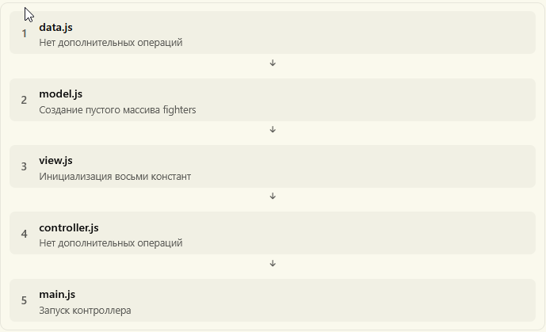

Рассмотрим код верхнего уровня каждого модуля. Тела функций для краткости опущены.

### `data.js`

```js
export async function fetchFighters() {
    // Тело функции
}
```

Функция `fetchFighters` уже создана на этапе Linking. Инструкций её вызова в модуле нет. Поэтому на этапе Evaluation никаких дополнительных операций не производится.

JSON-файл ещё не прочитан.

### `model.js`

```js
import { fetchFighters } from "./data.js";

let fighters = [];

export async function loadFighters() { ... }

export function getRanks() { ... }

export function getTotalCount() { ... }

export function getVisibleFighters(
    searchText = "",
    rank = "",
    sort = "default"
) { ... }
```

Связь импорта и четыре функции уже созданы на этапе Linking.

На этапе Evaluation выполняется одна операция:

```js
let fighters = [];
```

В оперативной памяти создаётся пустой массив. Переменная `fighters`, зарегистрированная на этапе Linking, получает ссылку на этот массив.

Теперь модель располагает хранилищем для данных о бойцах. Однако само хранилище пока пусто, поскольку функция `loadFighters()` ещё не вызвана.

### `view.js`

```js
const tbody = document.querySelector("#fighters");
const searchInput = document.querySelector("#search");
const rankSelect = document.querySelector("#rank");
const sortSelect = document.querySelector("#sort");
const reloadButton = document.querySelector("#reload");
const counter = document.querySelector("#counter");
const status = document.querySelector("#status");
const emptyMessage = document.querySelector("#empty");

export function readFilters() { ... }

export function bindEvents(onFilterChange, onReload) { ... }

export function renderRanks(ranks) { ... }

export function renderFighters(fighters) { ... }

export function renderCounter(visible, total) { ... }

export function showStatus(message, isError = false) { ... }

export function setLoading(loading) { ... }
```

Семь функций и привязки имён восьми констант уже созданы на этапе Linking.

На этапе Evaluation восемь раз вызывается метод `document.querySelector()`. Каждый вызов находит соответствующий элемент в DOM — объектной модели HTML-страницы — и возвращает ссылку на него. Эта ссылка становится значением соответствующей константы.

| Константа | Полученное значение |
| --------- | ------------------- |
| `tbody` | Ссылка на тело таблицы бойцов |
| `searchInput` | Ссылка на поле поиска |
| `rankSelect` | Ссылка на список званий |
| `sortSelect` | Ссылка на список способов сортировки |
| `reloadButton` | Ссылка на кнопку загрузки |
| `counter` | Ссылка на счётчик бойцов |
| `status` | Ссылка на поле состояния загрузки |
| `emptyMessage` | Ссылка на сообщение об отсутствии результатов |

Теперь функции представления могут обращаться к соответствующим HTML-элементам через эти константы. Однако сами функции представления ещё не вызваны. Таблица не заполнена, обработчики событий не зарегистрированы.

### `controller.js`

```js
import {
    loadFighters,
    getRanks,
    getTotalCount,
    getVisibleFighters
} from "./model.js";

import {
    bindEvents,
    readFilters,
    renderRanks,
    renderFighters,
    renderCounter,
    showStatus,
    setLoading
} from "./view.js";

function updateScreen() { ... }

async function reloadData() { ... }

export function startController() { ... }
```

Все связи импорта и три функции контроллера уже созданы на этапе Linking. Инструкций вызова функций на верхнем уровне модуля нет.

Поэтому на этапе Evaluation никаких дополнительных операций не производится.

## **1.4. Результат выполнения зависимых модулей**

К моменту завершения Evaluation четырёх зависимых модулей состояние приложения выглядит следующим образом:

| Сущность | После Linking | После Evaluation зависимых модулей |
| -------- | ------------- | ---------------------------------- |
| 15 функций | Созданы | Созданы |
| 13 связей импорта | Установлены | Установлены |
| Переменная `fighters` | Не инициализирована | Содержит ссылку на пустой массив |
| Восемь констант представления | Не инициализированы | Содержат ссылки на HTML-элементы |
| Данные о бойцах | Не загружены | Не загружены |
| Обработчики событий | Не зарегистрированы | Не зарегистрированы |
| Таблица бойцов | Не заполнена | Не заполнена |

Подготовка зависимых модулей завершена. Модель располагает пустым массивом для хранения данных, представление располагает ссылками на элементы DOM, контроллер располагает собственными функциями и доступом к функциям модели и представления.

Движок JavaScript может приступить к Evaluation входного модуля `main.js`.

## **2\. Запуск контроллера**

Код верхнего уровня модуля `main.js`:

```js
import { startController } from "./controller.js";

console.log("[MAIN] Запуск приложения MVC");
startController();
```

Связь с импортированной функцией `startController` уже установлена на этапе Linking. Поэтому на этапе Evaluation последовательно выполняются две инструкции.

Первая инструкция:

```js
console.log("[MAIN] Запуск приложения MVC");
```

Вызывает метод `console.log()`, который выводит сообщение о запуске приложения в консоль браузера.

Вторая инструкция:

```js
startController();
```

Вызывает функцию `startController`, определённую в модуле `controller.js`:

```js
export function startController() {
    bindEvents(updateScreen, reloadData);
    reloadData();
}
```

Управление передаётся в тело этой функции. Начинается выполнение прикладной логики контроллера.

Первым действием контроллера будет вызов функции `bindEvents()`, вторым — вызов функции `reloadData()`.

До этого момента приложение занималось исключительно подготовкой программного окружения. Теперь оно приступает к выполнению своих функциональных задач.

При этом с точки зрения движка JavaScript вызов `startController()` остаётся частью этапа Evaluation модуля `main.js`. Запуск контроллера — следующий этап логики самого приложения, а не отдельная стадия механизма загрузки JavaScript-модулей.

## **3\. Регистрация обработчиков событий**

После вызова `startController()` в main.js движок JavaScript приступает к последовательному выполнению инструкций, находящихся в теле этой функции в модуле `controller.js`.

```js
// main.js
startController(); => вызывает bindEvents(updateScreen, reloadData) и 
 reloadData(

// controller.js
export function startController() {
    bindEvents(updateScreen, reloadData);
    reloadData();
}

// созданные здесь функции
    //
function updateScreen() {
  const filters = readFilters();
  const visible = getVisibleFighters(filters.search, filters.rank, filters.sort);

  console.log("[CONTROLLER] Обновляем представление");
  renderFighters(visible);
  renderCounter(visible.length, getTotalCount());
}

/*
При вызове эта функция последовательно выполняет четыре основные операции:
1. Вызывает импортированную из view.js функцию readFilters() и 
получает текущие параметры поиска, фильтрации и сортировки.
2. Передаёт эти параметры импортированной из model.js 
функции getVisibleFighters() и получает от неё обработанный
 массив бойцов, который сохраняется в локальной константе visible.
3. Передаёт массив visible импортированной из view.js 
функции renderFighters(), которая заново строит таблицу бойцов в DOM.
4. Вызывает функцию модели getTotalCount(), получает 
общее количество бойцов и передаёт его вместе с количеством
 отобранных бойцов функции представления renderCounter(), к
оторая обновляет счётчик на странице.
*/

async function reloadData() {
  setLoading(true);
  showStatus("Читаем fighters.json…");
  try {
    await loadFighters();
    renderRanks(getRanks());
    updateScreen();
    showStatus("Данные успешно загружены из JSON");
  } catch (error) {
    console.error("[CONTROLLER] Ошибка загрузки:", error);
    showStatus("Ошибка: " + error.message, true);
  } finally {
    setLoading(false);
  }
}
/*
При вызове функция последовательно выполняет следующие операции:
1. Вызывает импортированную из view.js функцию setLoading(true), 
которая блокирует кнопку повторной загрузки и изменяет её надпись 
на «Загрузка…».
2. Вызывает импортированную из view.js функцию showStatus(), 
которая выводит на странице сообщение о начале чтения JSON-файла.
3. Вызывает импортированную из model.js асинхронную функцию 
loadFighters(), которая получает данные из data.js и сохраняет 
их в массиве fighters. Инструкция await приостанавливает 
выполнение reloadData() до завершения загрузки.
4. Вызывает импортированную из model.js функцию getRanks(), 
получает массив уникальных званий бойцов и передаёт его 
импортированной из view.js функции renderRanks(), которая заполняет 
выпадающий список званий.
5. Вызывает собственную функцию контроллера updateScreen(), 
которая организует фильтрацию, сортировку и отображение данных о бойцах.
6. Вызывает функцию представления showStatus(), которая 
выводит сообщение об успешной загрузке данных.
7. Если при выполнении инструкций внутри блока try возникает ошибка, 
управление передаётся блоку catch, который выводит сообщение 
об ошибке в консоль и на страницу.
8. Независимо от результата загрузки выполняется блок finally, 
внутри которого вызывается функция setLoading(false). 
Кнопка повторной загрузки разблокируется и получает 
первоначальную надпись.
*/
```

Первая инструкция вызывает функцию `bindEvents()`. Вторая инструкция reloadData(); будет выполнена после завершения работы первой функции.

### **3.1. Вызов функции** `bindEvents()`

```js
bindEvents(updateScreen, reloadData);
// сама функция во view:
export function bindEvents(onFilterChange, onReload) {
  searchInput.addEventListener("input", onFilterChange);
  rankSelect.addEventListener("change", onFilterChange);
  sortSelect.addEventListener("change", onFilterChange);
  reloadButton.addEventListener("click", onReload);
}
```

Функция `bindEvents` сама **не является обработчиком событий**. Она предназначена для регистрации других функций в качестве обработчиков событий.

| Функция | Модуль, в котором она определена | Назначение |
| ------- | -------------------------------- | ---------- |
| `bindEvents`(привязать события) | `view.js` | Регистрация обработчиков событий |
| `updateScreen` | `controller.js` | Получение параметров поиска, фильтрации и сортировки из представления, передача их модели, получение обработанного массива бойцов и передача его представлению для повторного построения таблицы и обновления счётчика |
| `reloadData` | `controller.js` | Организация загрузки данных из JSON-файла в модель, заполнение списка званий, вызов функции обновления таблицы и счётчика, управление состоянием кнопки загрузки и обработка ошибок |

Все три объекта функций были созданы в оперативной памяти на этапе Linking. Связь с функцией `bindEvents` была установлена посредством инструкции импорта в модуле `controller.js`.

Контроллер вызывает функцию `bindEvents()` и передаёт ей в качестве аргументов две другие функции — `updateScreen` и `reloadData`.

В JavaScript функции являются объектами. Как и другие объекты, их можно передавать в качестве аргументов другим функциям.

Обратите внимание на различие:

```js
updateScreen
```

Имя функции без круглых скобок позволяет получить сам объект функции.

```js
updateScreen()
```

Имя функции с круглыми скобками означает вызов функции и приводит к выполнению её тела.

В нашем случае контроллер передаёт представлению две функции, не вызывая их.

### **3.2. Получение аргументов функцией** `bindEvents()`

В модуле `view.js` функция `bindEvents` определена следующим образом:

```js
export function bindEvents(onFilterChange, onReload) {
    searchInput.addEventListener("input", onFilterChange);
    rankSelect.addEventListener("change", onFilterChange);
    sortSelect.addEventListener("change", onFilterChange);
    reloadButton.addEventListener("click", onReload);
}
```

При вызове функции `bindEvents()` движок JavaScript создаёт в оперативной памяти локальное окружение этого вызова. В нём создаются и инициализируются два параметра функции — `onFilterChange` и `onReload`.

Первый параметр получает ссылку на функцию `updateScreen`, второй — на функцию `reloadData`.

| Переданный аргумент | Параметр, получивший значение |
| ------------------- | ----------------------------- |
| `updateScreen` | `onFilterChange` |
| `reloadData` | `onReload` |

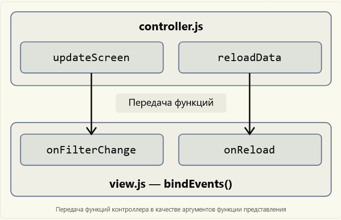

Новые объекты функций при этом не создаются. Параметры `onFilterChange` и `onReload` получают ссылки на уже существующие функции.

Функция, передаваемая другой функции для последующего вызова, называется **функцией обратного вызова (callback function)**.

Теперь движок JavaScript приступает к выполнению инструкций внутри тела `bindEvents()`.

### **3.3. Регистрация первого обработчика событий**

```js
searchInput.addEventListener("input", onFilterChange);
```

Константа `searchInput` была зарегистрирована на этапе Linking модуля `view.js` и получила своё значение на этапе Evaluation:

```js
const searchInput = document.querySelector("#search");
```

Она содержит ссылку на объект DOM, соответствующий полю поиска на HTML-странице.

У этого объекта вызывается метод `addEventListener()` — встроенный метод браузерного API, предназначенный для регистрации обработчиков событий.

Методу передаются два аргумента:

* `"input"` — название события, возникающего при изменении содержимого поля пользователем;
* `onFilterChange` — ссылка на функцию `updateScreen`, ранее полученную от контроллера.

Браузер сохраняет в памяти запись о том, что при возникновении события `input` на данном HTML-элементе необходимо вызвать функцию `updateScreen`.

Эта операция называется **регистрацией обработчика событий (event listener registration)**, или подпиской на событие.

Сама функция `updateScreen()` пока не вызывается.

### **3.4. Регистрация второго обработчика событий**

```js
rankSelect.addEventListener("change", onFilterChange);
```

Константа `rankSelect` содержит ссылку на объект DOM, соответствующий выпадающему списку званий.

Браузер регистрирует функцию `updateScreen` в качестве обработчика события `change`. Когда пользователь изменит выбранное звание, браузер вызовет эту функцию.

### **3.5. Регистрация третьего обработчика событий**

```js
sortSelect.addEventListener("change", onFilterChange);
```

Константа `sortSelect` содержит ссылку на объект DOM, соответствующий выпадающему списку способов сортировки.

Браузер регистрирует ту же функцию `updateScreen` в качестве обработчика события `change` для этого элемента.

Теперь одна и та же функция контроллера связана с тремя различными элементами пользовательского интерфейса.

### **3.6. Регистрация четвёртого обработчика событий**

```js
reloadButton.addEventListener("click", onReload);
```

Константа `reloadButton` содержит ссылку на объект DOM, соответствующий кнопке повторной загрузки данных.

Параметр `onReload` содержит ссылку на функцию `reloadData`, полученную от контроллера при вызове `bindEvents()`.

Браузер регистрирует функцию `reloadData` в качестве обработчика события `click`. Теперь при нажатии пользователем кнопки браузер будет вызывать эту функцию.

### **3.7. Результат выполнения функции** `bindEvents()`

В оперативной памяти браузера зарегистрированы четыре связи между HTML-элементами, событиями и функциями-обработчиками.

| Объект DOM | Событие | Функция-обработчик |
| ---------- | ------- | ------------------ |
| `searchInput` | `input` | `updateScreen` |
| `rankSelect` | `change` | `updateScreen` |
| `sortSelect` | `change` | `updateScreen` |
| `reloadButton` | `click` | `reloadData` |

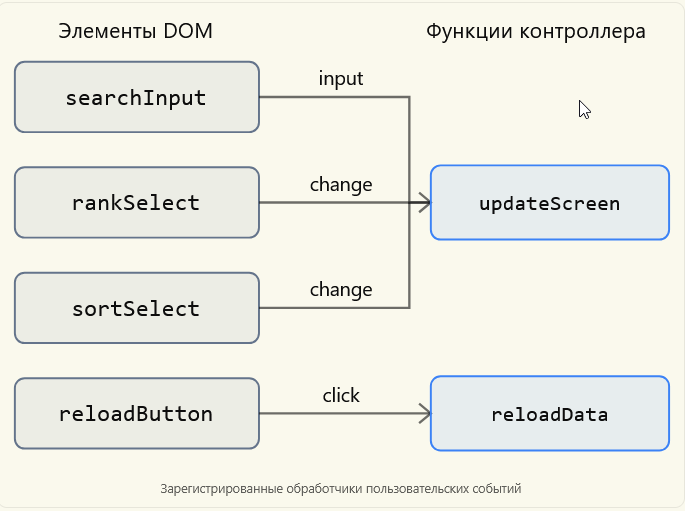

Функция `bindEvents()` завершает работу. Поскольку в её теле нет инструкции `return`, она возвращает значение `undefined`. Контроллер не использует это значение.

Локальное окружение вызова `bindEvents()` больше не требуется. Однако зарегистрированные обработчики сохраняются браузером и остаются доступными для последующих вызовов.

Управление возвращается в тело функции `startController()` в модуле `controller.js`.

```js
export function startController() {
    bindEvents(updateScreen, reloadData); // Выполнено
    reloadData();                        // Следующая операция
}
```

### **3.8. Состояние приложения после регистрации обработчиков**

| Сущность | Состояние |
| -------- | --------- |
| 15 функций приложения | Созданы |
| 13 связей импорта | Установлены |
| Массив `fighters` | Создан, но пуст |
| Восемь констант представления | Инициализированы |
| Четыре обработчика событий | Зарегистрированы |
| JSON-файл | Ещё не прочитан |
| Таблица бойцов | Не заполнена |

Приложение готово реагировать на действия пользователя, но пока не располагает данными о бойцах.

Следующая инструкция `reloadData()` запускает первоначальную загрузку данных из JSON-файла. Это будет следующий этап работы приложения.

# **4\. Первоначальная загрузка данных**

После завершения работы функции `bindEvents()` управление возвращается в тело функции `startController()` модуля `controller.js`. Движок JavaScript приступает к выполнению следующей инструкции:

```
export function startController() {
    bindEvents(updateScreen, reloadData); // Выполнено
    reloadData();                        // Выполняется
}
```

Вызывается функция `reloadData`, определённая в том же модуле `controller.js`. Объект этой функции был создан в оперативной памяти на этапе Linking. Никаких аргументов при вызове функции не передаётся.

## **4.1. Начало выполнения функции** `reloadData()`

В модуле `controller.js` функция определена следующим образом:

```
async function reloadData() {
    setLoading(true);
    showStatus("Читаем fighters.json…");

    try {
        await loadFighters();
        renderRanks(getRanks());
        updateScreen();
        showStatus("Данные успешно загружены из JSON");
    } catch (error) {
        console.error("[CONTROLLER] Ошибка загрузки:", error);
        showStatus("Ошибка: " + error.message, true);
    } finally {
        setLoading(false);
    }
}
```

Функция `reloadData` объявлена с помощью ключевого слова `async`. Это означает, что она является асинхронной функцией и всегда возвращает объект `Promise`.
**Promise (обещание)** — объект JavaScript, представляющий результат операции, которая может завершиться позднее. Он позволяет программе узнать, завершилась ли операция успешно или произошла ошибка, и получить результат её выполнения.
При вызове `reloadData()` движок JavaScript создаёт локальное окружение этого вызова и приступает к выполнению инструкций внутри тела функции.

## **4.2. Изменение состояния кнопки загрузки**

Первой выполняется инструкция:

```js
setLoading(true);
```

Функция `setLoading` определена в модуле `view.js`. Контроллер получил доступ к ней на этапе Linking посредством инструкции импорта.

```js
import {
    bindEvents,
    readFilters,
    renderRanks,
    renderFighters,
    renderCounter,
    showStatus,
    setLoading
} from "./view.js";
```

При вызове функции `setLoading()` контроллер передаёт ей аргумент `true` — логическое значение, обозначающее в данном случае начало загрузки.
В модуле `view.js` функция определена следующим образом:

```js
export function setLoading(loading) {
    reloadButton.disabled = loading;
    reloadButton.textContent = loading
        ? "Загрузка…"
        : "Загрузить JSON заново";
}
```

При вызове функции в её локальном окружении создаётся параметр `loading`, который получает переданное контроллером значение `true`.

| Аргумент | Параметр | Полученное значение |
| -------- | -------- | ------------------- |
| `true` | `loading` | `true` |

Далее последовательно выполняются две инструкции.

### **4.2.1. Блокировка кнопки**

```js
reloadButton.disabled = loading;
```

Константа `reloadButton` была инициализирована на этапе Evaluation модуля `view.js`:

```js
const reloadButton = document.querySelector("#reload");
```

Она содержит ссылку на объект DOM, соответствующий кнопке повторной загрузки данных.
Свойство `disabled` этого объекта определяет, доступна ли кнопка для взаимодействия с пользователем. Поскольку параметр `loading` содержит значение `true`, свойству `disabled` присваивается значение `true`.
Фактически выполняется следующая операция:

```js
reloadButton.disabled = true;
```

Кнопка становится недоступной для нажатия. Пользователь не может запустить повторную загрузку этой кнопкой, пока выполняется текущая.

### **4.2.2. Изменение надписи на кнопке**

```js
reloadButton.textContent = loading
    ? "Загрузка…"
    : "Загрузить JSON заново";
```

Здесь используется тернарный оператор — условное выражение, позволяющее выбрать одно из двух значений в зависимости от выполнения условия.
Его общая конструкция:

```js
условие ? значение1 : значение2
```

Если условие истинно, выражение возвращает первое значение, если ложно — второе.
Поскольку `loading` содержит `true`, выражение возвращает строку `"Загрузка…"`. Эта строка присваивается свойству `textContent` объекта DOM, соответствующего кнопке.

Функция `setLoading()` завершает работу и возвращает значение `undefined`, поскольку в её теле нет инструкции `return`. Управление возвращается в тело вызвавшей её функции `reloadData()` в модуле `controller.js`.

## **4.3. Вывод сообщения о начале загрузки**

Следующей выполняется инструкция:

```js
showStatus("Читаем fighters.json…");
```

Функция `showStatus` импортирована контроллером из модуля `view.js`, где она определена следующим образом:

```js
export function showStatus(message, isError = false) {
    status.textContent = message;
    status.classList.toggle("error", isError);
}
```

Контроллер передаёт функции один аргумент — строку `"Читаем fighters.json…"`.
При вызове функции создаются и инициализируются два локальных параметра:

| Параметр | Полученное значение | Источник значения |
| -------- | ------------------- | ----------------- |
| `message` | `"Читаем fighters.json…"` | Аргумент, переданный контроллером |
| `isError` | `false` | Значение по умолчанию |

Второй аргумент контроллер не передал, поэтому параметр `isError` получает значение по умолчанию, указанное при объявлении функции.

### **4.3.1. Изменение текста сообщения**

Выполняется инструкция:

```js
status.textContent = message;
```

Константа `status` была инициализирована на этапе Evaluation модуля `view.js`:

```js
const status = document.querySelector("#status");
```

Она содержит ссылку на объект DOM, соответствующий элементу страницы, предназначенному для вывода сообщений о состоянии приложения.
Свойству `textContent` этого объекта присваивается строка, полученная от контроллера.

### **4.3.2. Установка режима отображения сообщения**

```js
status.classList.toggle("error", isError);
```

Свойство `classList` содержит специальный объект, позволяющий работать со списком CSS-классов HTML-элемента.
Метод `toggle()` в данном случае получает два аргумента:

* `"error"` — название CSS-класса;
* `isError` — логическое значение, определяющее, должен ли этот класс присутствовать у элемента.

Поскольку `isError` содержит значение `false`, класс `error` удаляется, если он присутствовал у элемента. Сообщение отображается без оформления, предназначенного для ошибок.

Функция `showStatus()` завершает работу, возвращает значение `undefined`, и управление вновь передаётся функции `reloadData()`.

## **4.4. Состояние приложения перед загрузкой данных**

К этому моменту контроллер вызвал две функции представления. Обе функции изменили состояние объектов DOM.

| Сущность | Текущее состояние |
| -------- | ----------------- |
| `reloadButton.disabled` | `true` |
| `reloadButton.textContent` | `"Загрузка…"` |
| `status.textContent` | `"Читаем fighters.json…"` |
| CSS-класс `error` | Отсутствует у элемента `status` |
| Массив `fighters` | Пуст |
| Обработчики событий | Зарегистрированы |
| JSON-файл | Ещё не запрошен |
| Таблица бойцов | Не заполнена |

На этом этапе контроллер подготовил пользовательский интерфейс к загрузке данных. Сами данные ещё не запрошены.
Движок JavaScript переходит к следующей инструкции внутри функции `reloadData()`:

```js
try {
    await loadFighters();
    // Последующие инструкции
}
```

## **4.5. Вызов функции модели** `loadFighters()`

Контроллер приступает к выполнению инструкции:

```js
await loadFighters();
```

Функция `loadFighters` определена в модуле `model.js`. Доступ к ней контроллер получил на этапе Linking посредством инструкции импорта:

```js
import {
    loadFighters,
    getRanks,
    getTotalCount,
    getVisibleFighters
} from "./model.js";
```

В модуле `model.js` функция определена следующим образом:

```js
export async function loadFighters() {
    const loaded = await fetchFighters();
    fighters = loaded;
    console.log("[MODEL] Сохранено бойцов:", fighters.length);
}
```

Контроллер вызывает функцию `loadFighters()`, не передавая ей никаких аргументов.
Движок JavaScript создаёт локальное окружение вызова этой функции и приступает к выполнению её тела. Поскольку функция объявлена через `async`, её вызов возвращает объект `Promise`.
Ключевое слово `await` в функции контроллера означает, что дальнейшее выполнение `reloadData()` должно быть приостановлено до получения результата этого `Promise`.

## **4.6. Вызов функции** `fetchFighters()`

Первой инструкцией внутри функции `loadFighters()` является:

```js
const loaded = await fetchFighters();
```

Функция `fetchFighters` определена в модуле `data.js`. Модель получила доступ к ней на этапе Linking посредством инструкции импорта:

```js
import { fetchFighters } from "./data.js";
```

Модель вызывает функцию `fetchFighters()`, которая должна получить данные из JSON-файла и вернуть массив бойцов.
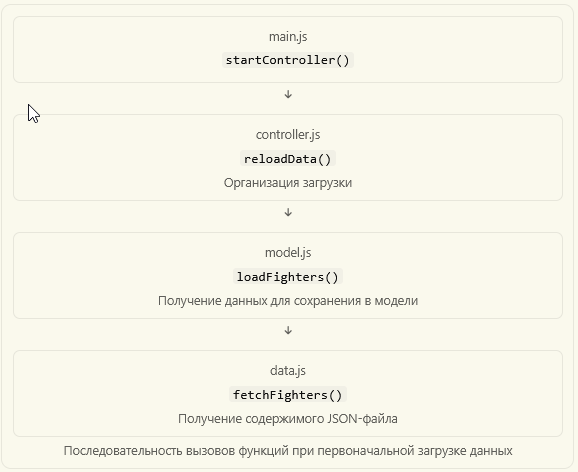
Таким образом, контроллер не обращается к JSON-файлу непосредственно. Он вызывает функцию модели, а модель вызывает функцию модуля доступа к данным.
Движок JavaScript переходит к выполнению тела функции `fetchFighters()` в модуле `data.js`. Именно внутри этой функции будет отправлен запрос на получение файла `fighters.json`.
Следующий этап — получение JSON-файла, преобразование его содержимого в объекты JavaScript и передача полученного массива обратно модели.

## **4.7. Получение данных из JSON-файла**

После вызова функции `fetchFighters()` из модуля `model.js` движок JavaScript приступает к выполнению тела этой функции, определённой в модуле `data.js`.

```js
export async function fetchFighters() {
    const response = await fetch("./fighters.json", {
        cache: "no-store"
    });

    if (!response.ok) {
        throw new Error(
            `HTTP ${response.status}: не удалось получить fighters.json`
        );
    }

    const data = await response.json();

    if (!Array.isArray(data.squad)) {
        throw new Error("Неверный формат JSON: ожидается массив squad");
    }

    console.log("[DATA] JSON получен:", data);

    return data.squad;
}
```

Функция `fetchFighters()` отвечает за получение содержимого файла `fighters.json`, преобразование его в объект JavaScript, проверку структуры полученных данных и передачу массива бойцов вызвавшей её функции `loadFighters()`.

### **4.7.1. Отправка запроса на получение JSON-файла**

Первой выполняется инструкция:

```js
const response = await fetch("./fighters.json", {
    cache: "no-store"
});
```

`fetch()` — встроенная функция браузерного API, предназначенная для отправки сетевых запросов и получения ответов на них.

| Аргумент | Назначение |
| -------- | ---------- |
| `"./fighters.json"` | Относительный адрес запрашиваемого файла |
| `{ cache: "no-store" }` | Объект с параметрами запроса, запрещающий использование и пополнение HTTP-кэша браузера для этого запроса |

Браузер определяет полный адрес файла `fighters.json` относительно базового адреса HTML-документа и отправляет HTTP-запрос серверу, на котором размещено приложение.
**HTTP-запрос** — сообщение, посредством которого браузер запрашивает у сервера определённый ресурс, например HTML-документ, изображение или JSON-файл.
Сервер получает запрос, находит файл `fighters.json` и, если файл доступен, отправляет его содержимое браузеру в составе HTTP-ответа.
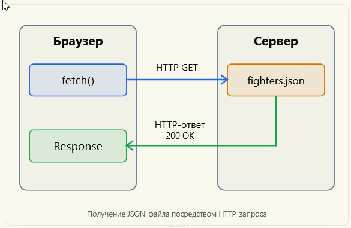

### **4.7.2. Приостановка выполнения асинхронных функций**

Функция `fetch()` не возвращает HTTP-ответ непосредственно. Она инициирует сетевой запрос и возвращает объект `Promise`, который первоначально находится в состоянии ожидания (`pending`).
Объект `Promise` может находиться в одном из трёх состояний:

| Состояние | Значение |
| --------- | -------- |
| `pending` | Операция ещё не завершена |
| `fulfilled` | Операция успешно завершена |
| `rejected` | Операция завершилась с ошибкой |

Ключевое слово `await` перед вызовом `fetch()` приостанавливает дальнейшее выполнение функции `fetchFighters()` до завершения соответствующего `Promise`.
Однако приостанавливается выполнение не всего приложения, а конкретной асинхронной функции. Браузер может продолжать обрабатывать другие события и выполнять другие задачи.
Проследим, что в этот момент происходит во всех вызывающих функциях.
В модуле `data.js`:

```js
const response = await fetch("./fighters.json", {
    cache: "no-store"
});
```

Функция `fetchFighters()` приостановлена в ожидании HTTP-ответа. Она возвращает вызвавшей её функции `loadFighters()` собственный объект `Promise`, находящийся в состоянии ожидания.
В модуле `model.js`:

```js
const loaded = await fetchFighters();
```

Функция `loadFighters()` также приостанавливается, поскольку ожидает завершения `Promise`, возвращённого функцией `fetchFighters()`. В свою очередь, она возвращает собственный объект `Promise` вызвавшей её функции `reloadData()`.
В модуле `controller.js`:

```js
await loadFighters();
```

Функция `reloadData()` также приостанавливается и возвращает собственный объект `Promise` вызвавшей её функции `startController()`.
Однако в теле `startController()` перед вызовом `reloadData()` ключевого слова `await` нет:

```js
export function startController() {
    bindEvents(updateScreen, reloadData);
    reloadData();
}
```

Поэтому `startController()` не ожидает завершения загрузки. Получив от `reloadData()` объект `Promise`, она завершает свою работу. Управление возвращается в `main.js`, где также больше нет инструкций для выполнения.
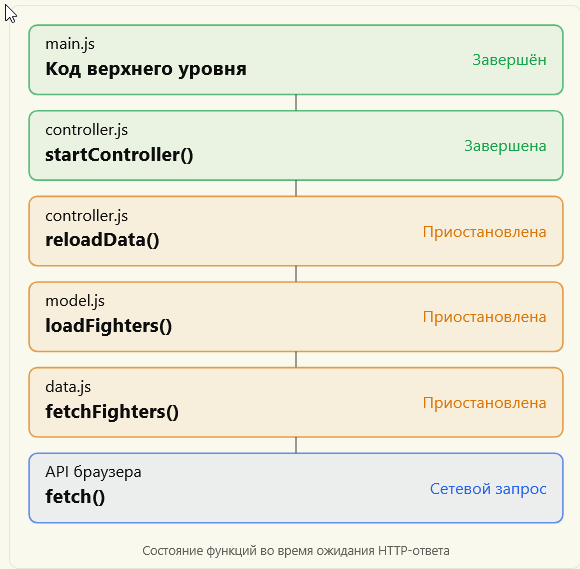
В оперативной памяти сохраняется состояние трёх приостановленных асинхронных вызовов. Это позволит движку JavaScript впоследствии продолжить выполнение их тел с того места, на котором оно было приостановлено.
На этом этапе выполнение кода верхнего уровня модуля `main.js` заканчивается. Этап Evaluation завершён, хотя первоначальная загрузка данных ещё продолжается.

### **4.7.3. Получение HTTP-ответа**

Когда браузер получает заголовки HTTP-ответа от сервера, объект `Promise`, возвращённый функцией `fetch()`, переходит в состояние `fulfilled`.
Результатом этого `Promise` является объект типа `Response`, представляющий HTTP-ответ сервера.
Движок JavaScript возобновляет выполнение функции `fetchFighters()` и завершает инструкцию:

```js
const response = await fetch("./fighters.json", {
    cache: "no-store"
});
```

Локальная константа `response` получает ссылку на объект `Response`, созданный браузером в оперативной памяти.
Объект `Response` содержит сведения об ответе сервера и предоставляет методы для чтения его содержимого.

| Свойство или метод | Назначение |
| ------------------ | ---------- |
| `response.status` | Числовой код HTTP-ответа |
| `response.ok` | Признак успешного HTTP-ответа |
| `response.headers` | Заголовки HTTP-ответа |
| `response.body` | Поток данных, содержащий тело ответа |
| `response.json()` | Чтение тела ответа и преобразование JSON в значение JavaScript |
| `response.text()` | Чтение тела ответа в виде текста |

На этом этапе константа `response` содержит ссылку на объект HTTP-ответа, а не на массив бойцов. Тело ответа ещё предстоит прочитать и обработать.

### **4.7.4. Проверка успешности HTTP-ответа**

Следующей выполняется инструкция:

```js
if (!response.ok) {
    throw new Error(
        `HTTP ${response.status}: не удалось получить fighters.json`
    );
}
```

Свойство `response.ok` содержит логическое значение. Если код HTTP-ответа находится в диапазоне от 200 до 299, оно равно `true`. В остальных случаях — `false`.
Оператор `!` — оператор логического отрицания. Он заменяет `true` на `false`, а `false` на `true`.

| Код HTTP | Значение `response.ok` | Значение `!response.ok` | Результат |
| -------- | -------------------- | --------------------- | --------- |
| 200 — успешный ответ | `true` | `false` | Продолжение работы |
| 403 — доступ запрещён | `false` | `true` | Создание и выбрасывание ошибки |
| 404 — файл не найден | `false` | `true` | Создание и выбрасывание ошибки |
| 500 — ошибка сервера | `false` | `true` | Создание и выбрасывание ошибки |

Если сервер вернул успешный ответ, условие `if` оказывается ложным и инструкции внутри блока пропускаются.
Если сервер вернул неуспешный HTTP-ответ, выполняется инструкция `throw new Error()`, которая создаёт объект ошибки и прерывает нормальное выполнение функции.
Для дальнейшего рассмотрения предположим, что сервер вернул успешный ответ с кодом 200.

### **4.7.5. Чтение и преобразование содержимого JSON-файла**

Выполняется следующая инструкция:

```js
const data = await response.json();
```

Метод `json()` объекта `Response` читает тело HTTP-ответа, содержащее JSON-текст, и преобразует его в соответствующее значение JavaScript.
Этот процесс называется **парсингом JSON (JSON parsing)** — синтаксическим разбором текста JSON с созданием соответствующих объектов, массивов и других значений JavaScript.
Например, следующий JSON-текст:

```js
{
    "squad": [
        {
            "name": "Алексей Петров",
            "age": 28,
            "rank": "сержант"
        }
    ]
}
```

будет преобразован в объект JavaScript, содержащий свойство `squad`. Значением этого свойства будет массив, элементом которого является объект с данными бойца. Здесь приведён сокращённый пример структуры данных.
Метод `response.json()` также возвращает объект `Promise`, поскольку чтение тела HTTP-ответа может потребовать времени. Ключевое слово `await` вновь приостанавливает выполнение функции `fetchFighters()`.
После завершения чтения и преобразования JSON движок JavaScript возобновляет выполнение функции и инициализирует локальную константу `data` ссылкой на созданный в оперативной памяти объект JavaScript.
**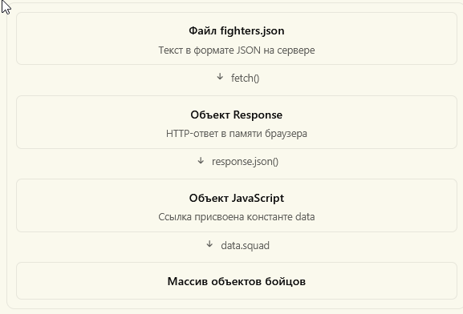**

### **4.7.6. Проверка структуры полученных данных**

Следующей выполняется инструкция:

```js
if (!Array.isArray(data.squad)) {
    throw new Error("Неверный формат JSON: ожидается массив squad");
}
```

Выражение `data.squad` позволяет получить значение свойства `squad` объекта, ссылка на который хранится в константе `data`.
Метод `Array.isArray()` проверяет, является ли переданное ему значение массивом.
Если свойство `squad` содержит массив, метод возвращает `true`. Оператор `!` преобразует это значение в `false`, поэтому блок `if` пропускается.
Если свойство `squad` отсутствует или содержит значение, не являющееся массивом, метод возвращает `false`. После логического отрицания получается `true`, и выполняется инструкция `throw new Error()`.
Эта проверка необходима, поскольку успешное преобразование JSON в объект JavaScript ещё не означает, что полученный объект имеет структуру, необходимую приложению.
В нашем случае проверяется только наличие массива `squad`, но не структура каждого входящего в него объекта.

### **4.7.7. Вывод полученных данных в консоль**

После успешной проверки выполняется инструкция:

```js
console.log("[DATA] JSON получен:", data);
```

Методу `console.log()` передаются два аргумента: строка с сообщением об успешном получении JSON и объект JavaScript, ссылка на который хранится в константе `data`.
В консоли браузера появляется сообщение, позволяющее разработчику проверить содержимое полученного объекта.

### **4.7.8. Возвращение массива бойцов**

Последней выполняется инструкция:

```js
return data.squad;
```

Движок JavaScript обращается к объекту, ссылка на который хранится в константе `data`, и получает значение его свойства `squad` — ссылку на массив объектов бойцов.
Поскольку `fetchFighters()` является асинхронной функцией, инструкция `return` не возвращает массив непосредственно вызвавшей её функции. Вместо этого ранее возвращённый объект `Promise` переходит в состояние `fulfilled`, а его результатом становится ссылка на массив бойцов.
Новый массив при этом не создаётся. Возвращается ссылка на массив, созданный при преобразовании JSON-текста в объект JavaScript.
Функция `fetchFighters()` завершает работу.

## **4.8. Передача данных из** `data.js` **в** `model.js`

Вернёмся к функции `loadFighters()` в модуле `model.js`:

```js
export async function loadFighters() {
    const loaded = await fetchFighters();
    fighters = loaded;
    console.log("[MODEL] Сохранено бойцов:", fighters.length);
}
```

Её выполнение было приостановлено на первой инструкции:

```js
const loaded = await fetchFighters();
```

Теперь объект `Promise`, возвращённый функцией `fetchFighters()`, содержит результат — ссылку на массив объектов бойцов.
Движок JavaScript возобновляет выполнение функции `loadFighters()` и завершает первую инструкцию. Локальная константа `loaded` получает ссылку на массив бойцов.

### **4.8.1. Сохранение массива бойцов в модели**

Следующей выполняется инструкция:

```js
fighters = loaded;
```

Переменная `fighters` была объявлена на верхнем уровне модуля `model.js`:

```js
let fighters = [];
```

На этапе Evaluation ей была присвоена ссылка на пустой массив.
Теперь движок JavaScript получает значение локальной константы `loaded` и присваивает его переменной `fighters`. Прежняя ссылка на пустой массив заменяется ссылкой на массив, полученный из JSON-файла.
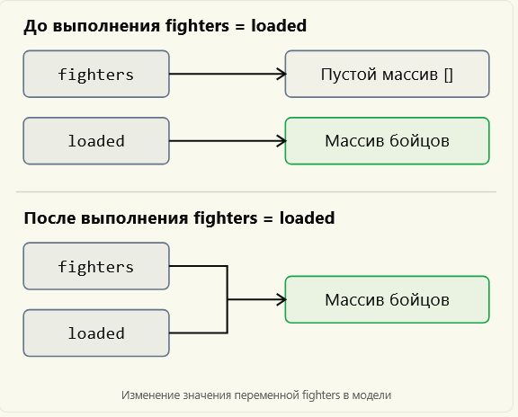
Массив не копируется. Обе сущности — переменная `fighters` и локальная константа `loaded` — теперь содержат ссылки на один и тот же объект в оперативной памяти.
Данные о бойцах сохранены в модели. Поскольку переменная `fighters` объявлена на верхнем уровне модуля, к ней могут обращаться все функции модуля `model.js`.

### **4.8.2. Вывод количества загруженных бойцов**

Выполняется последняя инструкция:

```js
console.log("[MODEL] Сохранено бойцов:", fighters.length);
```

Движок JavaScript обращается к массиву `fighters`, читает значение его свойства `length`, содержащего количество элементов массива, и передаёт это число методу `console.log()`.
В консоли браузера появляется сообщение о количестве бойцов, сохранённых в модели.

### **4.8.3. Завершение работы функции** `loadFighters()`

В теле функции `loadFighters()` нет инструкции `return`. Поэтому после завершения её работы ранее возвращённый объект `Promise` переходит в состояние `fulfilled` со значением `undefined`.
Локальная константа `loaded` больше не требуется. Однако массив бойцов продолжает существовать в оперативной памяти, поскольку ссылка на него хранится в переменной `fighters` модуля `model.js`.
**Контроллер не получает от функции** `loadFighters()` **массив бойцов.** Эта функция сохраняет массив внутри модели и сообщает контроллеру об успешном завершении операции посредством объекта `Promise`.

## **4.9. Возобновление работы контроллера**

Вернёмся к функции `reloadData()` в модуле `controller.js`:

```js
async function reloadData() {
    setLoading(true);                      // Выполнено
    showStatus("Читаем fighters.json…");    // Выполнено

    try {
        await loadFighters();              // Завершено
        renderRanks(getRanks());           // Следующая операция
        updateScreen();
        showStatus("Данные успешно загружены из JSON");
    } catch (error) {
        console.error("[CONTROLLER] Ошибка загрузки:", error);
        showStatus("Ошибка: " + error.message, true);
    } finally {
        setLoading(false);
    }
}
```

Выполнение функции `reloadData()` было приостановлено на инструкции `await loadFighters()`. Теперь соответствующий объект `Promise` перешёл в состояние `fulfilled`, и движок JavaScript возобновляет выполнение тела функции контроллера.

### Результат этапа загрузки данных

| Сущность | Состояние |
| -------- | --------- |
| HTTP-запрос | Выполнен |
| JSON-файл | Получен |
| JSON-текст | Преобразован в объект JavaScript |
| Структура данных | Проверена |
| `fetchFighters()` | Завершена |
| `loadFighters()` | Завершена |
| Переменная `fighters` | Содержит ссылку на массив бойцов |
| `reloadData()` | Выполнение возобновлено |
| Кнопка повторной загрузки | Заблокирована |
| Выпадающий список званий | Ещё не заполнен данными из модели |
| Таблица бойцов | Ещё не заполнена |

Модель теперь располагает данными, необходимыми для работы приложения. Контроллер может обращаться к функциям модели для получения этих данных и результатов их обработки.
Следующий этап — выполнение инструкции `renderRanks(getRanks())`, получение из модели списка уникальных воинских званий и заполнение соответствующего выпадающего списка на HTML-странице.

# 6\. Первоначальное построение таблицы бойцов

После завершения работы функции `renderRanks()` управление возвращается в тело функции `reloadData()` модуля `controller.js`.

Движок JavaScript приступает к выполнению следующей инструкции:

```js
updateScreen();
```

Функция `updateScreen` определена в самом модуле `controller.js`. Её объект был создан в оперативной памяти на этапе Linking. Контроллер вызывает эту функцию без аргументов.

## 6.1. Начало выполнения функции `updateScreen()`

В модуле `controller.js` функция определена следующим образом:

```js
function updateScreen() {
    const filters = readFilters();
    const visible = getVisibleFighters(
        filters.search, filters.rank, filters.sort
    );

    console.log("[CONTROLLER] Обновляем представление");
    renderFighters(visible);
    renderCounter(visible.length, getTotalCount());
}
```

При вызове функции движок JavaScript создаёт в оперативной памяти локальное окружение данного вызова. В нём регистрируются имена двух локальных констант — `filters` и `visible`. Значения они получат при выполнении соответствующих инструкций.

В теле функции `updateScreen()` вызываются пять функций, импортированных контроллером из модели и представления.

| Функция | Модуль | Назначение |
| ------- | ------ | ---------- |
| `readFilters()` | `view.js` | Чтение текущих значений элементов управления |
| `getVisibleFighters()` | `model.js` | Фильтрация и сортировка массива бойцов |
| `renderFighters()` | `view.js` | Построение таблицы на основе полученного массива |
| `getTotalCount()` | `model.js` | Получение общего количества бойцов |
| `renderCounter()` | `view.js` | Отображение количества отобранных и общего количества бойцов |

Движок JavaScript последовательно выполняет инструкции внутри тела `updateScreen()`.

## 6.2. Получение параметров поиска, фильтрации и сортировки

Первой выполняется инструкция:

```js
const filters = readFilters();
```

Для инициализации константы `filters` необходимо сначала вызвать функцию `readFilters()` и получить возвращаемое ею значение.

Эта функция определена в модуле `view.js`. Контроллер получил доступ к ней на этапе Linking посредством инструкции `import`.

```js
export function readFilters() {
    return {
        search: searchInput.value,
        rank: rankSelect.value,
        sort: sortSelect.value,
    };
}
```

Функция вызывается без аргументов. Все необходимые значения она получает из объектов DOM, ссылки на которые хранятся в константах модуля `view.js`.

### 6.2.1. Чтение значений объектов DOM

Внутри инструкции `return` находится литерал объекта — синтаксическая конструкция, предназначенная для создания объекта JavaScript посредством фигурных скобок и перечисления его свойств.

```js
{
    search: searchInput.value,
    rank: rankSelect.value,
    sort: sortSelect.value,
}
```

Движок JavaScript создаёт в оперативной памяти новый объект и последовательно вычисляет значения его трёх свойств.

**Свойство `search`.**

```js
search: searchInput.value
```

Константа `searchInput` содержит ссылку на объект DOM, соответствующий полю поиска. Свойство `value` этого объекта содержит текст, введённый пользователем. Движок читает этот текст и записывает его в свойство `search` создаваемого объекта.

**Свойство `rank`.**

```js
rank: rankSelect.value
```

Константа `rankSelect` содержит ссылку на объект DOM, соответствующий выпадающему списку воинских званий. Его свойство `value` содержит значение выбранного пункта. Движок читает это значение и записывает его в свойство `rank` создаваемого объекта.

**Свойство `sort`.**

```js
sort: sortSelect.value
```

Константа `sortSelect` содержит ссылку на объект DOM, соответствующий выпадающему списку способов сортировки. Движок читает значение выбранного пункта и записывает его в свойство `sort` создаваемого объекта.

Предположим, что при первоначальной загрузке поле поиска пусто, выбраны пункт «Все звания» и порядок сортировки по умолчанию.

| Объект DOM | Читаемое свойство | Полученное значение | Свойство создаваемого объекта |
| ---------- | ----------------- | ------------------- | ----------------------------- |
| `searchInput` | `value` | `""` | `search` |
| `rankSelect` | `value` | `""` | `rank` |
| `sortSelect` | `value` | `"default"` | `sort` |

В оперативной памяти создаётся объект:

```js
{
    search: "",
    rank: "",
    sort: "default"
}
```

### 6.2.2. Возвращение объекта контроллеру

Инструкция `return` возвращает ссылку на созданный объект вызвавшей функцию стороне — контроллеру.

Функция `readFilters()` завершает работу. Управление возвращается в тело функции `updateScreen()` модуля `controller.js`.

Движок JavaScript завершает выполнение инструкции:

```js
const filters = readFilters();
```

Локальная константа `filters` инициализируется ссылкой на объект, созданный функцией `readFilters()` в оперативной памяти.
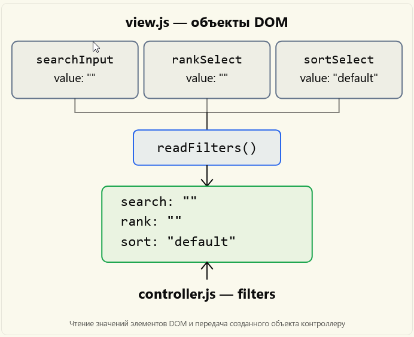
Контроллер теперь располагает сведениями о текущем состоянии элементов управления, но не обращался к DOM непосредственно. Всю работу по чтению значений элементов интерфейса выполнила функция представления.

## 6.3. Передача параметров фильтрации и сортировки модели

Следующей выполняется инструкция:

```js
const visible = getVisibleFighters(
    filters.search,
    filters.rank,
    filters.sort
);
```

Функция `getVisibleFighters` определена в модуле `model.js`. Контроллер получил доступ к ней на этапе Linking посредством инструкции импорта.

Перед вызовом функции движок JavaScript последовательно вычисляет значения трёх аргументов. Для этого он обращается к объекту, ссылка на который хранится в локальной константе `filters`, и читает значения его свойств.

```js
filters.search
filters.rank
filters.sort
```

В условиях нашего примера контроллер передаёт функции три строковых значения. Вызов равнозначен следующему:

```js
getVisibleFighters("", "", "default");
```

Обратите внимание: контроллер передаёт модели не весь объект `filters`, а три отдельных значения его свойств.

В модуле `model.js` функция определена следующим образом (исходные комментарии для краткости опущены):

```js
export function getVisibleFighters(
    searchText = "",
    rank = "",
    sort = "default"
) {
    const query = searchText.trim().toLocaleLowerCase("ru");

    const result = fighters.filter((fighter) => {
        const matchesText = [fighter.name, fighter.draftCity]
            .some((value) => value.toLocaleLowerCase("ru").includes(query));

        const matchesRank = !rank || fighter.rank === rank;

        return matchesText && matchesRank;
    });

    if (sort === "name")
        result.sort((a, b) => a.name.localeCompare(b.name, "ru"));

    if (sort === "ageAsc")
        result.sort((a, b) => a.age - b.age);

    if (sort === "ageDesc")
        result.sort((a, b) => b.age - a.age);

    console.log("[MODEL] После обработки:", result.length);

    return result;
}
```

### 6.3.1. Получение аргументов функцией `getVisibleFighters()`

При вызове функции движок JavaScript создаёт в оперативной памяти локальное окружение этого вызова. В нём создаются и инициализируются три параметра функции: `searchText`, `rank` и `sort`.

Кроме того, регистрируются имена двух локальных констант — `query` и `result`.

Параметры функции получают значения переданных контроллером аргументов в порядке их следования.

| Переданный аргумент | Параметр функции | Полученное значение |
| ------------------- | ---------------- | ------------------- |
| `filters.search` | `searchText` | `""` |
| `filters.rank` | `rank` | `""` |
| `filters.sort` | `sort` | `"default"` |

При объявлении функции каждому параметру также указано значение по умолчанию:

```js
searchText = ""
rank = ""
sort = "default"
```

Эти значения будут использованы, если при вызове функции соответствующие аргументы не переданы или имеют значение `undefined`. В нашем случае контроллер передал все три аргумента, поэтому значения по умолчанию не используются.

Теперь движок JavaScript приступает к выполнению тела функции.

### 6.3.2. Подготовка поискового запроса

Первой выполняется инструкция:

```js
const query = searchText.trim().toLocaleLowerCase("ru");
```

Локальный параметр `searchText` содержит строку, полученную контроллером из поля поиска.

У этой строки последовательно вызываются два метода.

**Метод `trim()`** удаляет пробельные символы в начале и конце строки.

**Метод `toLocaleLowerCase("ru")`** преобразует буквы строки в нижний регистр с учётом правил русского языка.

Результат первого метода непосредственно передаётся второму. Например, если пользователь ввёл строку `"  МОСКВА  "`, последовательность операций будет следующей:

```js
const searchText = "  МОСКВА  ";
// trim() → "МОСКВА"
// toLocaleLowerCase("ru") → "москва"
const query = searchText.trim().toLocaleLowerCase("ru");
```

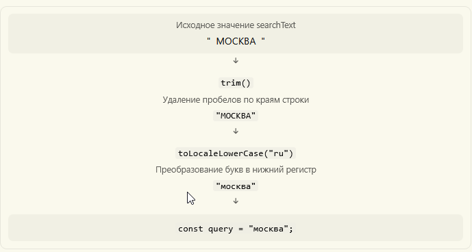
Полученное строковое значение используется для инициализации локальной константы `query`.

| Значение `searchText` | Результат `trim()` | Значение `query` |
| ------------------- | ---------------- | -------------- |
| `"  МОСКВА  "` | `"МОСКВА"` | `"москва"` |
| `"Петров"` | `"Петров"` | `"петров"` |
| `"Казань"` | `"Казань"` | `"казань"` |
| `""` | `""` | `""` |

При первоначальном запуске приложения поле поиска пусто. Поэтому константа `query` получает значение пустой строки.

```js
const query = "";
```

Исходное значение параметра `searchText` при этом не изменяется. Методы обработки строк возвращают строковые значения, не изменяя исходную строку.

## 6.4. Фильтрация массива бойцов

Следующей выполняется инструкция:

```js
const result = fighters.filter((fighter) => {
    const matchesText = [fighter.name, fighter.draftCity]
        .some((value) => value.toLocaleLowerCase("ru").includes(query));

    const matchesRank = !rank || fighter.rank === rank;

    return matchesText && matchesRank;
});
```

Переменная `fighters` объявлена на верхнем уровне модуля `model.js`. После завершения работы функции `loadFighters()` она содержит ссылку на массив объектов бойцов, загруженный из JSON-файла.

У этого массива вызывается встроенный метод JavaScript `filter()`.

**Метод `filter()`** создаёт новый массив, включая в него только те элементы исходного массива, для которых переданная ему функция возвращает истинное значение.

В качестве аргумента методу `filter()` передаётся стрелочная функция:

```js
(fighter) => {
    const matchesText = [fighter.name, fighter.draftCity]
        .some((value) => value.toLocaleLowerCase("ru").includes(query));

    const matchesRank = !rank || fighter.rank === rank;

    return matchesText && matchesRank;
}
```

В момент вычисления этого выражения движок JavaScript создаёт в оперативной памяти объект стрелочной функции и передаёт ссылку на него методу `filter()`.

Метод `filter()` начинает перебор массива `fighters`. Для каждого элемента массива он вызывает переданную ему стрелочную функцию.

При каждом вызове создаётся локальное окружение стрелочной функции, а её параметр `fighter` получает ссылку на очередной объект бойца.

Рассмотрим работу этой функции на примере одного объекта из условного массива:

```js
{
    name: "Алексей Петров",
    age: 28,
    draftCity: "Москва",
    rank: "сержант",
    role: "командир отделения"
}
```

### 6.4.1. Проверка соответствия поисковому запросу

Первой внутри стрелочной функции выполняется инструкция:

```js
const matchesText = [fighter.name, fighter.draftCity]
    .some((value) => value.toLocaleLowerCase("ru").includes(query));
```

Движок JavaScript читает значения двух свойств объекта `fighter`:

```js
fighter.name
fighter.draftCity
```

Из полученных значений в оперативной памяти создаётся временный массив:

```js
["Алексей Петров", "Москва"]
```

Массив не получает отдельного имени. У него непосредственно вызывается метод `some()`.

**Метод `some()`** проверяет, существует ли в массиве хотя бы один элемент, для которого переданная ему функция возвращает истинное значение. Если такой элемент найден, метод возвращает `true` и прекращает дальнейший перебор. Если ни один элемент не соответствует условию, метод возвращает `false`.

В качестве аргумента методу `some()` передаётся ещё одна стрелочная функция:

```js
(value) => value.toLocaleLowerCase("ru").includes(query)
```

Объект этой функции создаётся в оперативной памяти при выполнении рассматриваемой инструкции.

При каждом её вызове параметр `value` получает очередное строковое значение временного массива: имя бойца или город призыва.

Внутри функции последовательно вызываются два строковых метода:

```js
value.toLocaleLowerCase("ru").includes(query)
```

Первый преобразует строку в нижний регистр. Второй проверяет, содержится ли поисковый запрос `query` внутри полученной строки.

**Метод `includes()`**, вызванный у строки, возвращает `true`, если строка содержит указанную последовательность символов, и `false`, если не содержит.

Например:

```js
"алексей петров".includes("петров"); // true
"алексей петров".includes("москва"); // false
"москва".includes("москва");        // true
```

Предположим, что пользователь ввёл в поле поиска слово «Москва». В этом случае `query` содержит строку `"москва"`.

Метод `some()` сначала вызывает стрелочную функцию для строки `"Алексей Петров"`.

```js
"алексей петров".includes("москва");
```

Функция возвращает `false`. Метод `some()` продолжает перебор и вызывает её для следующего элемента массива:

```js
"москва".includes("москва");
```

Функция возвращает `true`. Метод `some()` завершает работу и также возвращает `true`.

Локальная константа `matchesText` инициализируется полученным логическим значением:

```js
const matchesText = true;
```

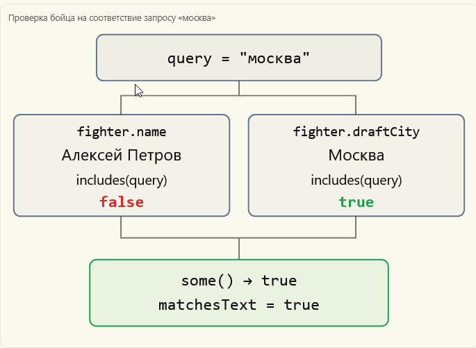
При первоначальном запуске приложения поисковый запрос представляет собой пустую строку:

```js
const query = "";
```

Метод `includes("")` возвращает `true` для любой строки, включая пустую. Поэтому уже при проверке имени бойца метод `some()` получит истинное значение и завершит работу.

Следовательно, при пустом поле поиска все бойцы удовлетворяют условию текстового поиска.

### 6.4.2. Проверка соответствия выбранному званию

Следующей внутри функции, переданной методу `filter()`, выполняется инструкция:

```js
const matchesRank = !rank || fighter.rank === rank;
```

Параметр `rank` принадлежит локальному окружению внешней функции `getVisibleFighters()`. Он содержит значение, переданное контроллером.

Стрелочная функция, вызванная методом `filter()`, имеет доступ к этому параметру, поскольку она создана внутри функции `getVisibleFighters()` и сохраняет связь с её лексическим окружением.

В выражении используются три оператора:

| Оператор | Название | Назначение |
| -------- | -------- | ---------- |
| `!` | Логическое отрицание | Преобразует значение в логическое и меняет его на противоположное |
| `===` | Строгое равенство | Проверяет совпадение значений без преобразования типов |
| \` |  | \` |

Выражение состоит из двух условий:

```js
!rank
```

и

```js
fighter.rank === rank
```

Первое условие проверяет, отсутствует ли ограничение по званию. Второе проверяет, совпадает ли звание бойца с выбранным пользователем званием.

**Случай первый. Звание не выбрано.**

Параметр `rank` содержит пустую строку:

```js
rank = "";
```

Пустая строка при преобразовании в логическое значение даёт `false`. Оператор логического отрицания преобразует его в `true`.

```js
!rank // true
```

Поскольку первый операнд логического ИЛИ уже равен `true`, второй операнд не вычисляется. Движок JavaScript не проверяет звание конкретного бойца.

Константа `matchesRank` получает значение `true`.

**Случай второй. Выбрано звание «сержант».**

Параметр `rank` содержит непустую строку:

```js
rank = "сержант";
```

При преобразовании в логическое значение непустая строка даёт `true`. Оператор `!` преобразует его в `false`.

Поэтому движок JavaScript переходит к вычислению второго операнда:

```js
fighter.rank === rank
```

Если звание бойца — «сержант», результатом сравнения будет `true`. Если звание другое, результатом будет `false`.

| Выбранное звание `rank` | Звание бойца `fighter.rank` | Значение `matchesRank` |
| --------------------- | ------------------------- | -------------------- |
| `""` | `"сержант"` | `true` |
| `""` | `"рядовой"` | `true` |
| `"сержант"` | `"сержант"` | `true` |
| `"сержант"` | `"рядовой"` | `false` |

При первоначальной загрузке выбран пункт «Все звания». Поэтому параметр `rank` содержит пустую строку, и все бойцы удовлетворяют условию фильтрации по званию.

### 6.4.3. Принятие решения о включении бойца в результирующий массив

Последней внутри стрелочной функции выполняется инструкция:

```js
return matchesText && matchesRank;
```

Оператор `&&` — логическое И. В нашем случае он соединяет два логических значения.

Для включения объекта бойца в результирующий массив необходимо одновременное выполнение двух условий: соответствие поисковому запросу и соответствие выбранному званию.

| `matchesText` | `matchesRank` | Результат `&&` | Действие метода `filter()` |
| ----------- | ----------- | ------------ | ------------------------ |
| `true` | `true` | `true` | Включает бойца в новый массив |
| `true` | `false` | `false` | Пропускает бойца |
| `false` | `true` | `false` | Пропускает бойца |
| `false` | `false` | `false` | Пропускает бойца |

Инструкция `return` возвращает логическое значение методу `filter()`, вызвавшему эту стрелочную функцию.

Метод `filter()` получает результат и на его основании принимает решение о включении ссылки на очередной объект бойца в создаваемый массив. После этого он переходит к следующему элементу исходного массива.

**Учебный пример фильтрации.** Поисковый запрос — «Москва», выбранное звание — «сержант».

| Боец | Город | Звание | `matchesText` | `matchesRank` | Результат |
| ---- | ----- | ------ | ----------- | ----------- | --------- |
| Алексей Петров | Москва | сержант | `true` | `true` | `true` |
| Иван Соколов | Казань | рядовой | `false` | `false` | `false` |
| Павел Орлов | Москва | рядовой | `true` | `false` | `false` |
| Андрей Волков | Пермь | ефрейтор | `false` | `false` | `false` |

В результирующий массив включается только Алексей Петров — один боец из четырёх.

### 6.4.4. Завершение фильтрации и создание массива `result`

После перебора всех элементов массива `fighters` метод `filter()` завершает работу и возвращает ссылку на созданный в оперативной памяти массив.

Движок JavaScript завершает выполнение инструкции:

```js
const result = fighters.filter(/* функция проверки */);
```

Локальная константа `result` получает ссылку на новый массив.

При первоначальной загрузке приложения оба ограничения отсутствуют: поисковый запрос пуст и конкретное звание не выбрано. Поэтому каждый объект исходного массива удовлетворяет обоим условиям, и в новый массив включаются все бойцы.

При этом исходный массив `fighters` и новый массив `result` являются двумя разными объектами в оперативной памяти. Однако содержащиеся в них элементы ссылаются на одни и те же объекты бойцов.

Такая операция называется **поверхностным копированием (shallow copy)**. Создаётся новый массив ссылок, но сами объекты бойцов не копируются.
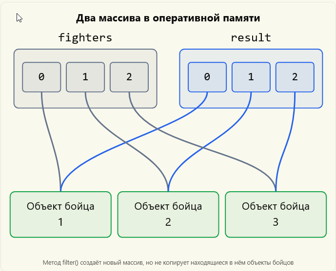

| Сущность | На что ссылаются элементы |
| -------- | ------------------------- |
| `fighters` | Исходные объекты бойцов |
| `result` | Те же объекты отобранных бойцов |

Создание отдельного массива позволяет впоследствии сортировать отобранных бойцов, не изменяя порядка элементов исходного массива `fighters`.

## 6.5. Сортировка отфильтрованного массива

После завершения фильтрации движок JavaScript переходит к выполнению следующих инструкций функции `getVisibleFighters()`:

```js
if (sort === "name")
    result.sort((a, b) => a.name.localeCompare(b.name, "ru"));

if (sort === "ageAsc")
    result.sort((a, b) => a.age - b.age);

if (sort === "ageDesc")
    result.sort((a, b) => b.age - a.age);
```

Локальный параметр `sort` содержит строковое значение, полученное от контроллера. Это значение контроллер ранее получил от функции представления `readFilters()`, прочитавшей свойство `sortSelect.value`.

Каждая из трёх инструкций `if` проверяет, какой способ сортировки выбран пользователем.

### 6.5.1. Сортировка по имени

Первой выполняется проверка:

```js
if (sort === "name")
```

Если параметр `sort` содержит строку `"name"`, вызывается метод `sort()` у массива `result`.

```js
result.sort((a, b) => a.name.localeCompare(b.name, "ru"));
```

Движок JavaScript создаёт объект стрелочной функции и передаёт ссылку на него методу `sort()`.

Метод `sort()` вызывает полученную функцию, передавая ей ссылки на два сравниваемых объекта бойцов. Параметры `a` и `b` получают эти ссылки.

Выражения `a.name` и `b.name` позволяют получить имена сравниваемых бойцов. Метод `localeCompare()` сравнивает эти строки по правилам русского языка и возвращает числовое значение, определяющее порядок расположения объектов.

Метод `sort()` использует возвращаемые числа для перестановки элементов массива `result`.

### 6.5.2. Сортировка по возрастанию возраста

Следующей выполняется проверка:

```js
if (sort === "ageAsc")
```

Сокращение `Asc` происходит от английского слова *ascending* — возрастающий.

Если пользователь выбрал сортировку по возрастанию возраста, вызывается метод:

```js
result.sort((a, b) => a.age - b.age);
```

В качестве аргумента ему передаётся стрелочная функция, которая получает ссылки на два объекта бойцов, читает значения их свойств `age` и вычисляет разность этих значений.

Например, если возраст первого бойца составляет 28 лет, а второго — 24 года:

```js
a.age - b.age
28 - 24
4
```

Положительный результат означает, что объект `a` должен располагаться после объекта `b`. Боец в возрасте 24 лет будет расположен перед бойцом в возрасте 28 лет.

| `a.age` | `b.age` | Результат `a.age - b.age` | Порядок расположения |
| ----- | ----- | ----------------------- | -------------------- |
| 24 | 28 | -4 | `a` перед `b` |
| 28 | 24 | 4 | `b` перед `a` |
| 25 | 25 | 0 | Возраст одинаковый, взаимный порядок сохраняется |

### 6.5.3. Сортировка по убыванию возраста

Последней выполняется проверка:

```js
if (sort === "ageDesc")
```

Сокращение `Desc` происходит от английского слова *descending* — убывающий.

Если выбран этот способ сортировки, вызывается метод:

```js
result.sort((a, b) => b.age - a.age);
```

Вычитание производится в обратном порядке. Благодаря этому первым в массиве оказывается объект бойца с наибольшим возрастом.

Во всех трёх случаях метод `sort()` изменяет порядок элементов уже существующего массива `result`. Новый массив не создаётся. Порядок элементов исходного массива `fighters` остаётся неизменным.

### 6.5.4. Что происходит при первоначальном запуске

При первоначальной загрузке параметр `sort` в нашем примере содержит значение `"default"`.

Движок JavaScript последовательно проверяет все три условия:

```js
sort === "name"    // false
sort === "ageAsc"  // false
sort === "ageDesc" // false
```

Ни одно условие не выполняется. Ни один метод `sort()` не вызывается. Объекты стрелочных функций, передаваемых этим методам, также не создаются, поскольку соответствующие выражения не вычисляются.

Массив `result` сохраняет порядок элементов, полученный при выполнении метода `filter()`.

| Значение параметра `sort` | Выполняемая операция |
| ----------------------- | -------------------- |
| `"default"` | Сохранение исходного порядка |
| `"name"` | Сортировка по имени |
| `"ageAsc"` | Сортировка по возрастанию возраста |
| `"ageDesc"` | Сортировка по убыванию возраста |

**Учебный пример сортировки.**

| Исходный порядок | По имени | По возрастанию возраста | По убыванию возраста |
| ---------------- | -------- | ----------------------- | -------------------- |
| Алексей Петров, 28 | Алексей Петров, 28 | Андрей Волков, 22 | Алексей Петров, 28 |
| Иван Соколов, 24 | Андрей Волков, 22 | Иван Соколов, 24 | Павел Орлов, 26 |
| Павел Орлов, 26 | Иван Соколов, 24 | Павел Орлов, 26 | Иван Соколов, 24 |
| Андрей Волков, 22 | Павел Орлов, 26 | Алексей Петров, 28 | Андрей Волков, 22 |

Исходный массив `fighters` не меняется при выборе способа сортировки.

## 6.6. Возвращение обработанного массива контроллеру

После выполнения инструкций фильтрации и сортировки движок JavaScript переходит к предпоследней инструкции функции `getVisibleFighters()`:

```js
console.log("[MODEL] После обработки:", result.length);
```

Движок читает свойство `length` массива `result`, определяет количество содержащихся в нём элементов и передаёт полученное число методу `console.log()` вместе с текстовым сообщением.

В консоли браузера появляется информация о количестве бойцов, соответствующих установленным условиям.

Последней выполняется инструкция:

```js
return result;
```

Функция `getVisibleFighters()` возвращает ссылку на созданный и обработанный массив вызвавшей её функции `updateScreen()`.

Управление возвращается в модуль `controller.js`.

Движок JavaScript завершает выполнение инструкции:

```js
const visible = getVisibleFighters(
    filters.search,
    filters.rank,
    filters.sort
);
```

Локальная константа `visible`, зарегистрированная при вызове `updateScreen()`, инициализируется ссылкой на массив, полученный от модели.

Название `visible` переводится как «видимый». В данном случае речь идёт о бойцах, сведения о которых должны быть отображены в таблице.

Локальное окружение завершившей работу функции `getVisibleFighters()` больше не требуется. Однако созданный ею массив продолжает существовать в оперативной памяти, поскольку ссылка на него теперь хранится в константе `visible` функции контроллера.

### 6.6.1. Результат работы модели

| Сущность | Состояние |
| -------- | --------- |
| `fighters` | Исходный массив всех бойцов в модуле `model.js` |
| `filters` | Ссылка на объект с параметрами обработки в функции `updateScreen()` |
| `query` | Локальная константа завершившей работу функции `getVisibleFighters()` |
| `result` | Локальная константа завершившей работу функции `getVisibleFighters()` |
| `visible` | Ссылка на массив отфильтрованных и отсортированных бойцов |
| Исходный массив `fighters` | Не изменён |
| Таблица бойцов в DOM | Ещё не заполнена |

На этом этапе контроллер получил необходимые данные от модели. Теперь он должен передать их представлению для построения таблицы.

## 6.7. Передача массива бойцов представлению

Вернёмся к функции `updateScreen()` модуля `controller.js`.

```js
function updateScreen() {
    const filters = readFilters(); // Выполнено

    const visible = getVisibleFighters(
        filters.search,
        filters.rank,
        filters.sort
    ); // Выполнено

    console.log("[CONTROLLER] Обновляем представление");

    renderFighters(visible);

    renderCounter(visible.length, getTotalCount());
}
```

Следующей выполняется инструкция `console.log()`, выводящая в консоль сообщение об обновлении представления.

После этого контроллер вызывает функцию:

```js
renderFighters(visible);
```

Функция `renderFighters` определена в модуле `view.js`. Контроллер получил доступ к ней на этапе Linking посредством инструкции импорта.

В качестве аргумента контроллер передаёт значение константы `visible` — ссылку на обработанный моделью массив бойцов.

| Модуль | Функция или константа | Действие |
| ------ | --------------------- | -------- |
| `view.js` | `readFilters()` | Читает значения элементов DOM |
| `controller.js` | `filters` | Хранит ссылку на объект параметров |
| `model.js` | `getVisibleFighters()` | Фильтрует и сортирует данные |
| `controller.js` | `visible` | Хранит ссылку на обработанный массив |
| `view.js` | `renderFighters(visible)` | Создаёт элементы таблицы в DOM |

В модуле `view.js` функция определена следующим образом:

```js
export function renderFighters(fighters) {
    tbody.replaceChildren();

    fighters.forEach((fighter, index) => {
        const row = document.createElement("tr");

        const values = [
            index + 1,
            fighter.name,
            fighter.age,
            fighter.draftCity,
            fighter.rank,
            fighter.role,
        ];

        for (const value of values) {
            const cell = document.createElement("td");
            cell.textContent = value;
            row.append(cell);
        }

        tbody.append(row);
    });

    emptyMessage.hidden = fighters.length !== 0;

    console.log("[VIEW] Нарисовано строк таблицы:", fighters.length);
}
```

## 6.8. Построение таблицы в DOM

### 6.8.1. Получение массива функцией `renderFighters()`

При вызове функции движок JavaScript создаёт в оперативной памяти локальное окружение этого вызова. В нём создаётся параметр `fighters`, которому присваивается переданная контроллером ссылка на массив.

| Аргумент | Параметр | Полученное значение |
| -------- | -------- | ------------------- |
| `visible` | `fighters` | Ссылка на обработанный моделью массив бойцов |

Здесь необходимо различать две одноимённые сущности.

В модуле `model.js` существует переменная `fighters`, объявленная на верхнем уровне модуля. Она содержит ссылку на исходный массив всех бойцов.

В функции `renderFighters()` существует локальный параметр `fighters`. Он содержит ссылку на другой массив — массив отобранных и отсортированных бойцов, переданный контроллером.

| Имя | Место объявления | Содержимое |
| --- | ---------------- | ---------- |
| `fighters` | Верхний уровень `model.js` | Ссылка на исходный массив всех бойцов |
| `visible` | Функция `updateScreen()` в `controller.js` | Ссылка на обработанный массив |
| `fighters` | Параметр функции `renderFighters()` в `view.js` | Ссылка на тот же обработанный массив |

Совпадение имён не означает, что речь идёт об одной переменной. Они принадлежат разным областям видимости.

### 6.8.2. Очистка содержимого таблицы

Первой выполняется инструкция:

```js
tbody.replaceChildren();
```

Константа `tbody` была объявлена на верхнем уровне модуля `view.js`:

```js
const tbody = document.querySelector("#fighters");
```

На этапе Evaluation она получила ссылку на объект DOM, соответствующий телу HTML-таблицы:

```html
<tbody id="fighters"></tbody>
```

У этого объекта вызывается метод `replaceChildren()` без аргументов.

Поскольку новые дочерние элементы методу не переданы, он удаляет все существующие дочерние узлы из тела таблицы.

При первоначальном запуске тело таблицы уже пусто. Однако при повторном вызове `renderFighters()`, например после изменения поискового запроса, эта инструкция удалит ранее созданные строки.

Очистка необходима для того, чтобы новые строки таблицы заменяли старые, а не добавлялись к ним.

Заголовок таблицы, находящийся в отдельном элементе `thead`, при этом не изменяется.

### 6.8.3. Перебор массива бойцов

Следующей выполняется инструкция:

```js
fighters.forEach((fighter, index) => {
    // Инструкции создания строки таблицы
});
```

**Метод `forEach()`** последовательно вызывает переданную ему функцию для каждого элемента массива. В отличие от `map()` и `filter()`, он не создаёт результирующий массив.

В данном случае метод используется для выполнения операций над DOM.

В качестве аргумента методу `forEach()` передаётся стрелочная функция с двумя параметрами:

```js
(fighter, index) => {
    // Тело функции
}
```

Движок JavaScript создаёт объект этой функции в оперативной памяти и передаёт ссылку на него методу `forEach()`.

При каждом вызове стрелочной функции метод `forEach()` передаёт ей очередной элемент массива и его порядковый индекс.

| Параметр | Получаемое значение |
| -------- | ------------------- |
| `fighter` | Ссылка на очередной объект бойца |
| `index` | Индекс этого объекта в обрабатываемом массиве |

Индексация элементов массива начинается с нуля. При первом вызове `index` равен `0`, при втором — `1`, при третьем — `2`.

Рассмотрим первую итерацию. Для объяснения используем тот же условный объект бойца:

```js
{
    name: "Алексей Петров",
    age: 28,
    draftCity: "Москва",
    rank: "сержант",
    role: "командир отделения"
}
```

### 6.8.4. Создание объекта строки таблицы

Первой внутри стрелочной функции выполняется инструкция:

```js
const row = document.createElement("tr");
```

`document` — предоставляемый браузером объект, представляющий текущий HTML-документ.

У этого объекта вызывается метод `createElement()`, предназначенный для создания новых объектов DOM.

Методу передаётся строка `"tr"` — имя HTML-тега, обозначающего строку таблицы (table row).

В оперативной памяти создаётся новый объект DOM, соответствующий следующему HTML-элементу:

```html
<tr></tr>
```

Метод `createElement()` возвращает ссылку на созданный объект. Этой ссылкой инициализируется локальная константа `row`.

Созданный объект пока не включён в DOM-дерево документа. Он существует в оперативной памяти, но ещё не является частью отображаемой таблицы.

### 6.8.5. Создание массива значений для ячеек строки

Следующей выполняется инструкция:

```js
const values = [
    index + 1,
    fighter.name,
    fighter.age,
    fighter.draftCity,
    fighter.rank,
    fighter.role,
];
```

Движок JavaScript создаёт в оперативной памяти новый массив из шести элементов.

Первым элементом становится результат выражения `index + 1`. При первой итерации значение `index` равно `0`, поэтому результатом сложения становится число `1`.

Остальные пять элементов массива получаются посредством чтения соответствующих свойств объекта `fighter`.

| Индекс элемента | Источник значения | Полученное значение |
| --------------- | ----------------- | ------------------- |
| 0 | `index + 1` | `1` |
| 1 | `fighter.name` | `"Алексей Петров"` |
| 2 | `fighter.age` | `28` |
| 3 | `fighter.draftCity` | `"Москва"` |
| 4 | `fighter.rank` | `"сержант"` |
| 5 | `fighter.role` | `"командир отделения"` |

В результате создаётся массив:

```js
[
    1,
    "Алексей Петров",
    28,
    "Москва",
    "сержант",
    "командир отделения"
]
```

Локальная константа `values` инициализируется ссылкой на этот массив.

Каждый элемент массива предназначен для заполнения одной ячейки будущей строки таблицы.

### 6.8.6. Создание ячеек строки таблицы

Следующей выполняется конструкция:

```js
for (const value of values) {
    const cell = document.createElement("td");
    cell.textContent = value;
    row.append(cell);
}
```

Цикл `for...of` последовательно перебирает все шесть элементов массива `values`.

При каждой итерации создаётся локальная константа `value`, которая получает очередное значение из массива.

Внутри цикла выполняются три инструкции.

**Первая инструкция — создание ячейки.**

```js
const cell = document.createElement("td");
```

Метод `createElement()` объекта `document` получает строку `"td"` — имя HTML-тега, обозначающего ячейку таблицы (table data).

В оперативной памяти создаётся объект DOM, соответствующий элементу:

```html
<td></td>
```

Ссылка на него присваивается локальной константе `cell`.

**Вторая инструкция — заполнение ячейки.**

```js
cell.textContent = value;
```

Свойству `textContent` созданного объекта DOM присваивается очередное значение массива `values`.

При первой итерации значение `value` равно числу `1`. При записи в свойство `textContent` оно преобразуется в строку `"1"`.

Объект DOM теперь соответствует элементу:

```html
<td>1</td>
```

**Третья инструкция — добавление ячейки в строку.**

```js
row.append(cell);
```

Константа `row` содержит ссылку на созданный ранее объект строки таблицы.

У этого объекта вызывается метод `append()`, предназначенный для добавления дочерних узлов. В качестве аргумента передаётся ссылка на созданный объект ячейки.

Браузер включает объект `cell` в число дочерних узлов объекта `row`.

После первой итерации созданная строка имеет следующую структуру:

```html
<tr>
    <td>1</td>
</tr>
```

После этого цикл переходит к следующему элементу массива `values`, создаёт ещё одну ячейку, записывает в неё имя бойца и добавляет её к той же строке.

Так повторяется шесть раз.

| Итерация | Значение `value` | Количество ячеек в `row` |
| -------- | -------------- | ---------------------- |
| 1 | `1` | 1 |
| 2 | `"Алексей Петров"` | 2 |
| 3 | `28` | 3 |
| 4 | `"Москва"` | 4 |
| 5 | `"сержант"` | 5 |
| 6 | `"командир отделения"` | 6 |

После завершения цикла `for...of` объект DOM, ссылка на который хранится в константе `row`, содержит шесть дочерних элементов.

Его структура эквивалентна следующей HTML-разметке:

```html
<tr>
    <td>1</td>
    <td>Алексей Петров</td>
    <td>28</td>
    <td>Москва</td>
    <td>сержант</td>
    <td>командир отделения</td>
</tr>
```

Все необходимые ячейки созданы и заполнены значениями. Однако сама строка по-прежнему не включена в тело таблицы.

### 6.8.7. Добавление созданной строки в таблицу

После завершения внутреннего цикла `for...of` выполняется последняя инструкция стрелочной функции, переданной методу `forEach()`:

```js
tbody.append(row);
```

Константа `tbody` содержит ссылку на объект DOM тела таблицы. Константа `row` содержит ссылку на созданную и заполненную строку.

Метод `append()` получает ссылку на объект строки и включает его в число дочерних узлов объекта `tbody`.

Созданная строка вместе со всеми шестью ячейками становится частью DOM-дерева HTML-документа.

```html
<tbody id="fighters">
    <tr>
        <td>1</td>
        <td>Алексей Петров</td>
        <td>28</td>
        <td>Москва</td>
        <td>сержант</td>
        <td>командир отделения</td>
    </tr>
</tbody>
```

При последующем обновлении изображения страницы браузер отобразит добавленные в DOM элементы.

| № | Имя | Возраст | Город | Звание | Должность |
| --- | --- | ------- | ----- | ------ | --------- |
| 1 | Алексей Петров | 28 | Москва | сержант | командир отделения |

Стрелочная функция завершает работу. Управление возвращается методу `forEach()`, который переходит к следующему объекту бойца и снова вызывает ту же функцию.

### 6.8.8. Создание остальных строк таблицы

Для каждого следующего бойца повторяется весь рассмотренный процесс.

При каждом вызове стрелочной функции создаётся новое локальное окружение. Параметры `fighter` и `index` получают новые значения. Создаются новый объект строки `row`, новый массив `values` и шесть новых объектов ячеек.

Ранее созданные строки и ячейки продолжают существовать в оперативной памяти, поскольку они включены в DOM-дерево документа.

Если обрабатываемый массив содержит четыре объекта бойцов, метод `forEach()` вызовет стрелочную функцию четыре раза, а внутренний цикл `for...of` выполнит в общей сложности двадцать четыре итерации.

В результате будут созданы четыре строки и двадцать четыре ячейки.

После перебора всех элементов массива метод `forEach()` завершает работу и возвращает значение `undefined`. Управление возвращается в тело функции `renderFighters()`.

## 6.9. Управление сообщением об отсутствии результатов

После завершения построения таблицы движок JavaScript выполняет следующую инструкцию функции `renderFighters()`:

```js
emptyMessage.hidden = fighters.length !== 0;
```

Константа `emptyMessage` объявлена на верхнем уровне модуля `view.js`:

```js
const emptyMessage = document.querySelector("#empty");
```

На этапе Evaluation эта константа получила ссылку на объект DOM, соответствующий элементу страницы, предназначенному для вывода сообщения об отсутствии результатов.

Свойство `hidden` объекта DOM определяет, должен ли соответствующий элемент быть скрыт.

Чтобы вычислить присваиваемое этому свойству значение, движок JavaScript сначала читает свойство `length` массива `fighters`, а затем выполняет строгое сравнение с числом `0`:

```js
fighters.length !== 0
```

Оператор `!==` — оператор строгого неравенства. Он возвращает `true`, если сравниваемые значения различаются, и `false`, если они совпадают.

Если массив содержит хотя бы одного бойца, результатом сравнения становится `true`. Свойство `hidden` получает значение `true`, и сообщение об отсутствии результатов скрывается.

Если массив пуст, результатом сравнения становится `false`. Свойство `hidden` получает значение `false`, и сообщение становится видимым.

| `fighters.length` | Результат `fighters.length !== 0` | Значение `emptyMessage.hidden` | Состояние сообщения |
| --------------- | ------------------------------- | ---------------------------- | ------------------- |
| 10 | `true` | `true` | Скрыто |
| 3 | `true` | `true` | Скрыто |
| 1 | `true` | `true` | Скрыто |
| 0 | `false` | `false` | Отображается |

## 6.10. Завершение работы функции `renderFighters()`

Последней выполняется инструкция:

```js
console.log(
    "[VIEW] Нарисовано строк таблицы:",
    fighters.length
);
```

Методу `console.log()` передаются два аргумента: строка с информационным сообщением и число, соответствующее количеству объектов в обработанном массиве бойцов.

Поскольку для каждого объекта массива была создана одна строка таблицы, значение `fighters.length` соответствует количеству созданных строк.

Все инструкции функции `renderFighters()` выполнены. Инструкции `return` в её теле нет, поэтому функция возвращает значение `undefined`.

Контроллер не использует возвращённое значение. Назначение функции состояло в изменении объектов DOM, а не в получении нового массива или других данных.

Локальное окружение вызова функции `renderFighters()` больше не требуется. Однако созданные объекты строк и ячеек продолжают существовать в оперативной памяти, поскольку они включены в DOM-дерево документа.

Управление возвращается в тело функции `updateScreen()` модуля `controller.js`.

## 6.11. Результат построения таблицы

К этому моменту модель выполнила обработку данных, а представление построило таблицу на основе полученного массива.

| Сущность | Текущее состояние |
| -------- | ----------------- |
| Массив `fighters` в модели | Содержит исходные данные обо всех бойцах |
| Константа `filters` в контроллере | Содержит ссылку на объект параметров обработки |
| Константа `visible` в контроллере | Содержит ссылку на обработанный массив |
| `getVisibleFighters()` | Выполнение завершено |
| `renderFighters()` | Выполнение завершено |
| Объект DOM `tbody` | Содержит созданные строки таблицы |
| Объекты DOM `tr` | Созданы и включены в тело таблицы |
| Объекты DOM `td` | Созданы, заполнены данными и включены в строки |
| `emptyMessage.hidden` | Установлено в соответствии с количеством бойцов |
| Счётчик бойцов | Ещё не обновлён |
| Кнопка повторной загрузки | Заблокирована |
| `updateScreen()` | Продолжает выполнение |
| `reloadData()` | Ожидает завершения вызванной функции `updateScreen()` |

Вернёмся к функции `updateScreen()`:

```js
function updateScreen() {
    const filters = readFilters(); // Выполнено

    const visible = getVisibleFighters(
        filters.search,
        filters.rank,
        filters.sort
    ); // Выполнено

    console.log("[CONTROLLER] Обновляем представление"); // Выполнено

    renderFighters(visible); // Выполнено

    renderCounter(visible.length, getTotalCount()); // Следующая операция
}
```

Движок JavaScript приступает к выполнению последней инструкции функции контроллера:

```js
renderCounter(visible.length, getTotalCount());
```

Для вызова функции представления `renderCounter()` контроллеру необходимо получить два числовых значения: количество бойцов, включённых в таблицу, и общее количество бойцов, хранящихся в модели.

Следующий этап — обновление счётчика бойцов, завершение функции `updateScreen()`, возвращение управления функции `reloadData()` и окончание первоначальной загрузки приложения.

# 7\. Обновление счётчика бойцов

После завершения работы функции `renderFighters()` управление возвращается в тело функции `updateScreen()` модуля `controller.js`.

Движок JavaScript приступает к выполнению последней инструкции этой функции:

```js
renderCounter(visible.length, getTotalCount());
```

В данной инструкции объединены три операции: получение количества элементов обработанного массива, вызов функции модели для получения общего количества бойцов и вызов функции представления для обновления счётчика на странице.

## 7.1. Вычисление первого аргумента

Прежде чем вызвать функцию `renderCounter()`, движок JavaScript должен вычислить значения передаваемых ей аргументов. Аргументы вычисляются последовательно, слева направо.

Первым вычисляется выражение:

```js
visible.length
```

Локальная константа `visible` была инициализирована ранее, при выполнении инструкции:

```js
const visible = getVisibleFighters(
    filters.search,
    filters.rank,
    filters.sort
);
```

Она содержит ссылку на массив бойцов, полученный от модели в результате фильтрации и сортировки.

Движок JavaScript обращается к этому массиву и читает значение его свойства `length`. Полученное число соответствует количеству бойцов, сведения о которых были включены в таблицу при выполнении функции `renderFighters()`.

Первый аргумент вычислен. Теперь необходимо вычислить второй.

## 7.2. Получение общего количества бойцов

Для вычисления второго аргумента вызывается функция:

```js
getTotalCount()
```

Функция определена в модуле `model.js`. Контроллер получил доступ к ней на этапе Linking посредством инструкции импорта:

```js
import {
    loadFighters,
    getRanks,
    getTotalCount,
    getVisibleFighters
} from "./model.js";
```

В модуле `model.js` функция определена следующим образом:

```js
export function getTotalCount() {
    return fighters.length;
}
```

Контроллер вызывает функцию без аргументов. Движок JavaScript создаёт локальное окружение вызова и приступает к выполнению тела функции.

Внутри функции находится одна инструкция:

```js
return fighters.length;
```

Переменная `fighters` объявлена на верхнем уровне модуля `model.js`:

```js
let fighters = [];
```

После завершения первоначальной загрузки она содержит ссылку на исходный массив всех бойцов, полученный из JSON-файла.

Движок JavaScript обращается к этому массиву, читает значение его свойства `length` и возвращает полученное число контроллеру посредством инструкции `return`.

Функция `getTotalCount()` завершает работу.

## 7.3. Различие между двумя полученными значениями

Контроллер располагает двумя числовыми значениями, которые получены из разных массивов.

| Выражение | Источник значения | Что обозначает |
| --------- | ----------------- | -------------- |
| `visible.length` | Обработанный массив бойцов в контроллере | Количество бойцов, соответствующих условиям поиска и фильтрации |
| `getTotalCount()` | Исходный массив `fighters` в модели | Общее количество загруженных бойцов |

При первоначальном запуске приложения, когда поле поиска пусто и конкретное звание не выбрано, оба значения совпадают.

Если впоследствии пользователь установит ограничения поиска или фильтрации, количество элементов массива `visible` может оказаться меньше количества элементов исходного массива `fighters`.

Например, предположим, что исходный массив содержит десять бойцов.

| Условие фильтрации | `visible.length` | `getTotalCount()` |
| ------------------ | -------------- | --------------- |
| Все бойцы | 10 | 10 |
| Найдены три бойца | 3 | 10 |
| Найден один боец | 1 | 10 |
| Ничего не найдено | 0 | 10 |

Числа в таблице условные и используются для объяснения механизма работы счётчика.

## 7.4. Вызов функции представления `renderCounter()`

После вычисления обоих аргументов движок JavaScript вызывает функцию `renderCounter()`, определённую в модуле `view.js`.

```js
export function renderCounter(visible, total) {
    counter.textContent = `Показано: ${visible} из ${total}`;
}
```

При вызове функции создаётся её локальное окружение, в котором создаются и инициализируются два параметра — `visible` и `total`.

Предположим, что при первоначальной загрузке приложение получило десять бойцов. В таком случае выполняемый вызов равнозначен следующему:

```js
renderCounter(10, 10);
```

| Аргумент | Параметр | Полученное значение | Тип данных |
| -------- | -------- | ------------------- | ---------- |
| `visible.length` | `visible` | `10` | `number` |
| `getTotalCount()` | `total` | `10` | `number` |

Обратим внимание на совпадение имён двух программных сущностей.

В функции `updateScreen()` модуля `controller.js` константа `visible` содержит ссылку на массив.

В функции `renderCounter()` модуля `view.js` параметр `visible` содержит число.

| Имя | Место объявления | Содержимое |
| --- | ---------------- | ---------- |
| `visible` | Локальная константа функции `updateScreen()` | Ссылка на обработанный массив бойцов |
| `visible` | Параметр функции `renderCounter()` | Количество элементов обработанного массива |
| `total` | Параметр функции `renderCounter()` | Общее количество бойцов |

Это разные сущности, принадлежащие разным локальным окружениям. Совпадение имён не создаёт между ними никакой автоматической связи.

**Передача двух числовых значений функции представления**

| `controller.js` — выражение аргумента | Значение | `view.js` — параметр |
| ----------------------------------- | -------- | ------------------ |
| `visible.length` | 10 | `visible` |
| `getTotalCount()` | 10 | `total` |

Результат на странице: «Показано: 10 из 10».

## 7.5. Формирование строки для счётчика

Внутри функции `renderCounter()` выполняется инструкция:

```js
counter.textContent = `Показано: ${visible} из ${total}`;
```

В правой части инструкции присваивания находится шаблонный литерал.

**Шаблонный литерал (template literal)** — способ создания строки JavaScript с использованием обратных кавычек, позволяющий включать в строку результаты вычисления выражений посредством конструкции `${...}`.

Движок JavaScript последовательно вычисляет выражения внутри шаблонного литерала: `${visible}` и `${total}`.

Затем преобразует полученные числовые значения в строки и подставляет их в соответствующие места шаблона.

В нашем примере:

```js
`Показано: ${10} из ${10}`
```

Результатом вычисления шаблонного литерала становится строка:

```js
"Показано: 10 из 10"
```

Сама строка не получает отдельного имени. Полученное значение непосредственно используется в операции присваивания.

В развёрнутом учебном варианте эту же функцию можно было бы записать следующим образом:

```js
export function renderCounter(visible, total) {
    const message = `Показано: ${visible} из ${total}`;
    counter.textContent = message;
}
```

В исходном коде приложения константа `message` отсутствует.

## 7.6. Изменение объекта DOM

Константа `counter` была объявлена на верхнем уровне модуля `view.js`:

```js
const counter = document.querySelector("#counter");
```

На этапе Evaluation она получила ссылку на объект DOM, соответствующий HTML-элементу счётчика бойцов.

После вычисления шаблонного литерала движок JavaScript присваивает полученную строку свойству `textContent` этого объекта.

В нашем примере выполняется операция, эквивалентная следующей:

```js
counter.textContent = "Показано: 10 из 10";
```

Браузер изменяет текстовое содержимое соответствующего элемента DOM. При очередном обновлении изображения страницы пользователь увидит новое значение счётчика.

**Демонстрация работы `renderCounter()`**

Общее количество бойцов — 10.

| Вызов функции | Значение `counter.textContent` |
| ------------- | ---------------------------- |
| `renderCounter(10, 10)` | Показано: 10 из 10 |
| `renderCounter(5, 10)` | Показано: 5 из 10 |
| `renderCounter(3, 10)` | Показано: 3 из 10 |
| `renderCounter(0, 10)` | Показано: 0 из 10 |

## 7.7. Завершение работы функции `renderCounter()`

Все инструкции функции `renderCounter()` выполнены.

Поскольку в теле функции отсутствует инструкция `return`, она возвращает значение `undefined`.

Контроллер не использует это значение. Назначение функции состояло в изменении текстового содержимого объекта DOM.

Локальное окружение вызова функции `renderCounter()` больше не требуется. Параметры `visible` и `total` становятся недоступными, однако внесённые в DOM изменения сохраняются.

Управление возвращается в тело функции `updateScreen()` модуля `controller.js`.

## 7.8. Завершение работы функции `updateScreen()`

Рассмотрим состояние инструкций функции `updateScreen()`:

```js
function updateScreen() {
    const filters = readFilters(); // Выполнено

    const visible = getVisibleFighters(
        filters.search,
        filters.rank,
        filters.sort
    ); // Выполнено

    console.log("[CONTROLLER] Обновляем представление"); // Выполнено

    renderFighters(visible); // Выполнено

    renderCounter(visible.length, getTotalCount()); // Выполнено
}
```

Все инструкции функции выполнены. Других инструкций в её теле нет.

Функция `updateScreen()` завершает работу и возвращает значение `undefined`.

Локальные константы `filters` и `visible` становятся недоступными. Созданные при данном вызове объект параметров фильтрации и обработанный массив могут впоследствии быть удалены из оперативной памяти механизмом сборки мусора, если на них больше нет доступных ссылок.

**Сборка мусора (garbage collection)** — автоматический механизм освобождения оперативной памяти от объектов, которые больше недоступны выполняемой программе.

При этом исходный массив `fighters` продолжает существовать, поскольку ссылка на него хранится в переменной верхнего уровня модуля `model.js`.

Созданные строки и ячейки таблицы также продолжают существовать, поскольку включены в DOM-дерево документа.

Таблица не зависит от дальнейшего существования обработанного массива `visible`: значения его элементов уже были прочитаны и записаны в текстовое содержимое ячеек таблицы.

## 7.9. Полная последовательность работы функции `updateScreen()`

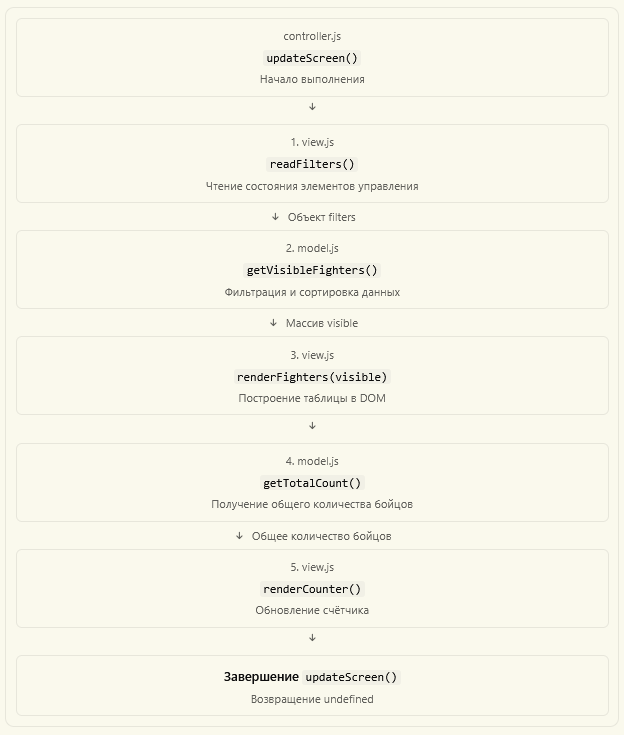

| Шаг | Модуль | Функция | Операция и результат |
| --- | ------ | ------- | -------------------- |
| Начало | `controller.js` | `updateScreen()` | Запуск цикла обновления |
| 1 | `view.js` | `readFilters()` | Чтение состояния элементов управления, возврат объекта `filters` |
| 2 | `model.js` | `getVisibleFighters()` | Фильтрация и сортировка, возврат массива `visible` |
| 3 | `view.js` | `renderFighters(visible)` | Построение таблицы в DOM |
| 4 | `model.js` | `getTotalCount()` | Получение общего количества бойцов |
| 5 | `view.js` | `renderCounter()` | Обновление счётчика |
| Завершение | `controller.js` | `updateScreen()` | Возвращение `undefined` |

Функция `updateScreen()` организует законченный цикл взаимодействия трёх компонентов архитектуры MVC.

Представление сообщает контроллеру текущее состояние элементов управления. Контроллер передаёт полученные значения модели. Модель обрабатывает данные и возвращает результат контроллеру. Контроллер передаёт результат представлению, которое обновляет соответствующие элементы DOM.

Эта последовательность будет повторяться при каждом изменении поискового запроса, выбранного звания или способа сортировки.

## 7.10. Возвращение управления функции `reloadData()`

Функция `updateScreen()` была вызвана из тела асинхронной функции `reloadData()`.

После завершения её работы управление возвращается в точку вызова:

```js
async function reloadData() {
    setLoading(true);                     // Выполнено
    showStatus("Читаем fighters.json…");   // Выполнено

    try {
        await loadFighters();             // Выполнено
        renderRanks(getRanks());          // Выполнено
        updateScreen();                   // Выполнено

        showStatus("Данные успешно загружены из JSON");
        // Следующая операция

    } catch (error) {
        console.error("[CONTROLLER] Ошибка загрузки:", error);
        showStatus("Ошибка: " + error.message, true);
    } finally {
        setLoading(false);
    }
}
```

Обратим внимание, что `updateScreen()` является синхронной функцией. Контроллер не использует `await` при её вызове. Движок JavaScript выполняет всё её тело и только после завершения функции переходит к следующей инструкции внутри `reloadData()`.

## 7.11. Состояние приложения после обновления счётчика

| Сущность | Текущее состояние |
| -------- | ----------------- |
| Исходный массив `fighters` | Содержит все загруженные данные |
| Выпадающий список званий | Заполнен |
| Таблица бойцов | Построена в DOM |
| Счётчик бойцов | Обновлён |
| Сообщение об отсутствии результатов | Скрыто при наличии бойцов |
| `getTotalCount()` | Выполнение завершено |
| `renderCounter()` | Выполнение завершено |
| `updateScreen()` | Выполнение завершено |
| Локальные константы `filters` и `visible` | Больше недоступны |
| Обработчики событий | Зарегистрированы |
| Кнопка повторной загрузки | Пока заблокирована |
| Сообщение о состоянии | «Читаем fighters.json…» |
| `reloadData()` | Продолжает выполнение |

Все основные элементы пользовательского интерфейса заполнены данными. Однако процедура первоначальной загрузки ещё не завершена.

Контроллеру предстоит вывести сообщение об успешной загрузке, завершить выполнение блока `try`, выполнить блок `finally`, разблокировать кнопку повторной загрузки и завершить работу асинхронной функции `reloadData()`.

Это будет следующий этап — **завершение первоначальной загрузки и переход приложения в режим ожидания пользовательских событий**.

# 8\. Завершение первоначальной загрузки приложения

После завершения работы функции `updateScreen()` управление возвращается в тело асинхронной функции `reloadData()` модуля `controller.js`.

К этому моменту данные загружены в модель, выпадающий список званий заполнен, таблица бойцов построена, счётчик обновлён. Однако кнопка повторной загрузки всё ещё заблокирована, а сообщение о состоянии приложения по-прежнему информирует пользователя о чтении JSON-файла.

Контроллеру предстоит завершить процедуру загрузки.

Рассмотрим состояние инструкций функции `reloadData()`:

```js
async function reloadData() {
    setLoading(true);                     // Выполнено
    showStatus("Читаем fighters.json…");   // Выполнено

    try {
        await loadFighters();             // Выполнено
        renderRanks(getRanks());          // Выполнено
        updateScreen();                   // Выполнено

        showStatus("Данные успешно загружены из JSON");

    } catch (error) {
        console.error("[CONTROLLER] Ошибка загрузки:", error);
        showStatus("Ошибка: " + error.message, true);
    } finally {
        setLoading(false);
    }
}
```

## 8.1. Вывод сообщения об успешной загрузке данных

Следующей выполняется инструкция:

```js
showStatus("Данные успешно загружены из JSON");
```

Функция `showStatus` определена в модуле `view.js`. Контроллер получил доступ к ней посредством инструкции импорта на этапе Linking.

Объект этой функции уже существует в оперативной памяти. Более того, контроллер ранее вызывал эту функцию для вывода сообщения о начале загрузки.

```js
export function showStatus(message, isError = false) {
    status.textContent = message;
    status.classList.toggle("error", isError);
}
```

Движок JavaScript создаёт новое локальное окружение вызова функции и инициализирует два параметра.

| Параметр | Полученное значение | Источник значения |
| -------- | ------------------- | ----------------- |
| `message` | `"Данные успешно загружены из JSON"` | Аргумент контроллера |
| `isError` | `false` | Значение по умолчанию |

Выполняется первая инструкция:

```js
status.textContent = message;
```

Константа `status` содержит ссылку на объект DOM, соответствующий элементу страницы, предназначенному для отображения состояния приложения.

Движок JavaScript присваивает свойству `textContent` этого объекта новое строковое значение. Прежнее сообщение «Читаем fighters.json…» заменяется сообщением «Данные успешно загружены из JSON».

Следующей выполняется инструкция:

```js
status.classList.toggle("error", isError);
```

Поскольку параметр `isError` содержит значение `false`, метод `toggle()` удаляет CSS-класс `error`, если он присутствует у элемента.

| Свойство объекта DOM | До вызова `showStatus()` | После вызова `showStatus()` |
| -------------------- | ---------------------- | ------------------------- |
| `status.textContent` | `"Читаем fighters.json…"` | `"Данные успешно загружены из JSON"` |
| CSS-класс `error` | Отсутствует | Отсутствует |

Функция `showStatus()` завершает работу и возвращает значение `undefined`. Управление возвращается в тело функции `reloadData()`.

## 8.2. Завершение выполнения блока `try`

В функции `reloadData()` все операции загрузки и отображения данных заключены в конструкцию `try...catch...finally`.

```js
try {
    await loadFighters();
    renderRanks(getRanks());
    updateScreen();
    showStatus("Данные успешно загружены из JSON");
} catch (error) {
    console.error("[CONTROLLER] Ошибка загрузки:", error);
    showStatus("Ошибка: " + error.message, true);
} finally {
    setLoading(false);
}
```

Конструкция `try...catch...finally` предназначена для управления выполнением программы в ситуациях, когда при выполнении инструкций могут возникать ошибки.

Она состоит из трёх блоков.

| Блок | Назначение | Условие выполнения |
| ---- | ---------- | ------------------ |
| `try` | Выполнение основных операций | Выполняется при достижении конструкции |
| `catch` | Обработка возникшей ошибки | Выполняется при исключении внутри блока `try` |
| `finally` | Выполнение завершающих операций | Выполняется независимо от успешности операций в `try` и `catch` |

В рассматриваемом сценарии все инструкции внутри блока `try` выполнены успешно. Ни одна функция не выбросила исключение, а объекты `Promise`, результаты которых ожидались посредством `await`, не завершились с ошибкой.

Поэтому движок JavaScript пропускает блок `catch` и переходит непосредственно к блоку `finally`.

| Сценарий | Последовательность выполнения |
| -------- | ----------------------------- |
| Ошибки нет | `try` → `finally` |
| Возникла ошибка | `try` (прерывается) → `catch` → `finally` |

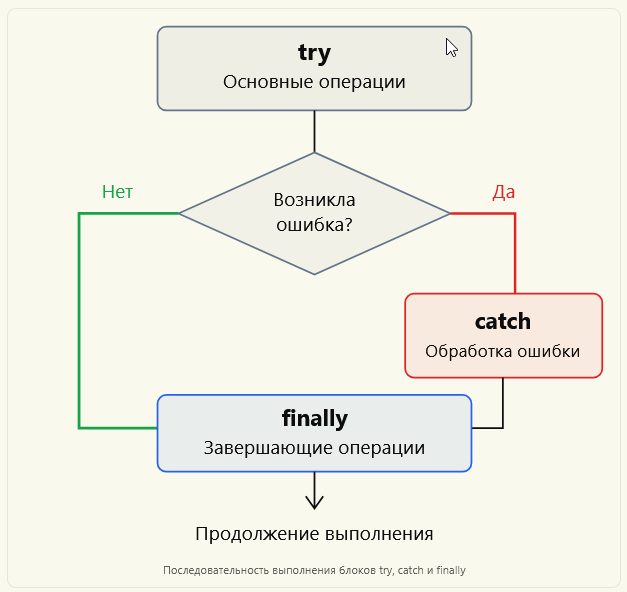

## 8.3. Выполнение блока `finally`

Внутри блока `finally` находится одна инструкция:

```js
finally {
    setLoading(false);
}
```

Контроллер вызывает функцию `setLoading()`, определённую в модуле `view.js`, и передаёт ей логическое значение `false`.

Эта функция уже вызывалась в начале процедуры загрузки, но тогда ей было передано противоположное значение — `true`.

```js
export function setLoading(loading) {
    reloadButton.disabled = loading;
    reloadButton.textContent = loading
        ? "Загрузка…"
        : "Загрузить JSON заново";
}
```

При вызове функции создаётся новое локальное окружение. Параметр `loading` инициализируется значением переданного аргумента.

| Аргумент | Параметр | Полученное значение |
| -------- | -------- | ------------------- |
| `false` | `loading` | `false` |

Движок JavaScript приступает к последовательному выполнению двух инструкций функции.

### 8.3.1. Разблокировка кнопки повторной загрузки

Первой выполняется инструкция:

```js
reloadButton.disabled = loading;
```

Константа `reloadButton` была объявлена на верхнем уровне модуля `view.js`:

```js
const reloadButton = document.querySelector("#reload");
```

На этапе Evaluation она получила ссылку на объект DOM, соответствующий кнопке повторной загрузки данных.

Свойству `disabled` этого объекта присваивается значение параметра `loading`.

Поскольку параметр содержит значение `false`, выполняемая операция равнозначна следующей:

```js
reloadButton.disabled = false;
```

Кнопка становится доступной для взаимодействия с пользователем.

При этом зарегистрированный ранее обработчик события `click` сохраняется. Блокировка кнопки не удаляла обработчик событий, поэтому повторно вызывать метод `addEventListener()` не требуется.

### 8.3.2. Восстановление первоначальной надписи кнопки

Следующей выполняется инструкция:

```js
reloadButton.textContent = loading
    ? "Загрузка…"
    : "Загрузить JSON заново";
```

Движок JavaScript вычисляет тернарное условное выражение в правой части инструкции присваивания.

Поскольку значение параметра `loading` равно `false`, выражение возвращает вторую строку:

```js
"Загрузить JSON заново"
```

Полученная строка присваивается свойству `textContent` объекта кнопки.

```js
reloadButton.textContent = "Загрузить JSON заново";
```

Обе инструкции функции выполнены.

Сопоставим результаты двух вызовов одной и той же функции.

| Свойство объекта DOM | После `setLoading(true)` | После `setLoading(false)` |
| -------------------- | ---------------------- | ----------------------- |
| `reloadButton.disabled` | `true` | `false` |
| `reloadButton.textContent` | `"Загрузка…"` | `"Загрузить JSON заново"` |
| Доступность кнопки | Заблокирована | Разблокирована |
| Обработчик события `click` | Зарегистрирован | Зарегистрирован |

Функция `setLoading()` завершает работу и возвращает значение `undefined`. Управление возвращается в блок `finally` функции `reloadData()`.

Других инструкций в этом блоке нет.

## 8.4. Почему функция `setLoading(false)` помещена в блок `finally`

Рассмотрим два возможных сценария первоначальной загрузки.

В первом случае JSON-файл успешно получен, данные обработаны и интерфейс обновлён.

Во втором случае на одном из этапов возникает ошибка. Например, сервер не находит JSON-файл и возвращает HTTP-ответ с кодом 404.

Если бы инструкция разблокировки кнопки находилась в конце блока `try`, то при возникновении ошибки движок JavaScript мог бы до неё не дойти.

```js
try {
    await loadFighters();
    renderRanks(getRanks());
    updateScreen();

    showStatus("Данные успешно загружены из JSON");

    setLoading(false);
} catch (error) {
    showStatus("Ошибка: " + error.message, true);
}
```

Это условный пример менее удачной организации кода, а не исходный код нашего приложения.

Если функция `loadFighters()` завершится с ошибкой, выполнение блока `try` прервётся на инструкции `await loadFighters()`. Управление перейдёт в блок `catch`.

Инструкция `setLoading(false)` будет пропущена. Кнопка останется заблокированной, и пользователь не сможет запустить повторную загрузку посредством этой кнопки.

Размещение инструкции в блоке `finally` решает эту проблему.

```js
finally {
    setLoading(false);
}
```

Независимо от того, была ли загрузка успешной или произошла ошибка, контроллер возвращает кнопку в рабочее состояние.

| Результат загрузки | Выполнение `catch` | Выполнение `finally` | Конечное состояние кнопки |
| ------------------ | ---------------- | ------------------ | ------------------------- |
| Успешная загрузка | Нет | Да | Разблокирована |
| Ошибка загрузки | Да | Да | Разблокирована |
| Ошибка обработки данных | Да | Да | Разблокирована |
| Ошибка построения таблицы | Да | Да | Разблокирована |

Таблица предполагает, что сама функция `setLoading(false)` выполняется без ошибок.

## 8.5. Завершение работы асинхронной функции `reloadData()`

После выполнения блока `finally` в теле функции `reloadData()` не остаётся инструкций.

Напомним, что эта функция объявлена посредством ключевого слова `async`:

```js
async function reloadData() {
    // Инструкции загрузки и отображения данных
}
```

При её первоначальном вызове был создан объект `Promise`.

На этапе получения данных выполнение функции приостановилось на инструкции:

```js
await loadFighters();
```

Объект `Promise`, возвращённый самой функцией `reloadData()`, оставался в состоянии `pending` на протяжении всей процедуры загрузки и последующего выполнения её тела.

Теперь выполнение функции завершено.

Поскольку в её теле нет инструкции `return`, объект `Promise` переходит в состояние `fulfilled` со значением `undefined`.

| Характеристика объекта Promise | До завершения `reloadData()` | После завершения `reloadData()` |
| ------------------------------ | -------------------------- | ----------------------------- |
| Состояние | `pending` | `fulfilled` |
| Результат | Ещё не получен | `undefined` |

Следует различать два события: успешную загрузку данных приложением и успешное завершение объекта `Promise`.

Даже если при загрузке возникнет ошибка, но она будет полностью обработана внутри блока `catch`, а блок `finally` выполнится успешно, объект `Promise` функции `reloadData()` перейдёт в состояние `fulfilled`.

Причина состоит в том, что обработанная ошибка больше не прерывает выполнение функции. В исходном коде блок `catch` не выбрасывает полученное исключение повторно.

## 8.6. Куда возвращается управление после завершения `reloadData()`

Вспомним, каким образом была вызвана эта функция:

```js
export function startController() {
    bindEvents(updateScreen, reloadData);
    reloadData();
}
```

Вызов `reloadData()` не сопровождался ключевым словом `await`.

Поэтому функция `startController()` завершилась ещё на этапе ожидания HTTP-ответа. Модуль `main.js`, вызвавший её, также завершил выполнение своего кода верхнего уровня.

В момент окончательного завершения функции `reloadData()` ни `startController()`, ни код верхнего уровня `main.js` уже не выполняются.

Движок JavaScript не возвращается к исполнению их инструкций. Завершается асинхронная операция, ранее запущенная контроллером.

Объект `Promise`, возвращённый функцией `reloadData()`, получает окончательный результат. Поскольку вызывающая сторона не использовала этот объект и не зарегистрировала обработчики его завершения, никаких дополнительных действий в приложении это не инициирует.

| Момент | `main.js` и `startController()` | `reloadData()` |
| ------ | --------------------------- | ------------ |
| Запуск | Инициируют загрузку | Начинает выполнение |
| Ожидание HTTP-ответа | Завершают работу | Приостановлена, Promise — `pending` |
| Получение данных | Уже завершены | Возобновляет работу и обновляет DOM |
| Конец загрузки | Уже завершены | Завершена, Promise — `fulfilled` |

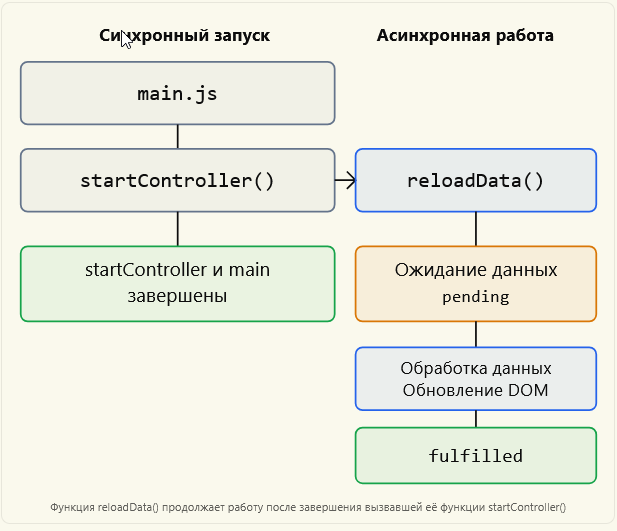

## 8.7. Что сохраняется в оперативной памяти после завершения загрузки

Завершение всех первоначальных вызовов функций не означает прекращения существования приложения.

В оперативной памяти браузера сохраняются программные сущности, необходимые для его дальнейшей работы.

### Объекты функций

Все пятнадцать объектов функций, созданных на этапе Linking, остаются доступными в окружениях соответствующих модулей.

Окончание вызова функции не означает уничтожения самого объекта функции. Завершается конкретный вызов, а функцию можно вызвать повторно.

Например, функция `updateScreen()` завершила первоначальное построение таблицы, но её объект продолжает существовать и может быть вызван браузером при изменении поискового запроса.

### Исходный массив данных

Переменная `fighters` модуля `model.js` продолжает содержать ссылку на исходный массив бойцов.

```js
let fighters = [];
```

Эта переменная принадлежит окружению модуля, а не локальному окружению какой-либо функции.

После завершения `loadFighters()`, `getVisibleFighters()` и `updateScreen()` сохранённые в модели данные остаются доступными для последующей обработки.

### Объекты DOM

Восемь констант модуля `view.js` продолжают содержать ссылки на объекты DOM.

```js
const tbody = document.querySelector("#fighters");
const searchInput = document.querySelector("#search");
const rankSelect = document.querySelector("#rank");
const sortSelect = document.querySelector("#sort");
const reloadButton = document.querySelector("#reload");
const counter = document.querySelector("#counter");
const status = document.querySelector("#status");
const emptyMessage = document.querySelector("#empty");
```

Созданные при первоначальной загрузке строки таблицы, ячейки и пункты выпадающего списка включены в DOM-дерево документа и также продолжают существовать.

### Зарегистрированные обработчики событий

При выполнении функции `bindEvents()` браузер сохранил четыре записи, связывающие объекты DOM, события и функции-обработчики.

| Объект DOM | Событие | Зарегистрированная функция |
| ---------- | ------- | -------------------------- |
| `searchInput` | `input` | `updateScreen` |
| `rankSelect` | `change` | `updateScreen` |
| `sortSelect` | `change` | `updateScreen` |
| `reloadButton` | `click` | `reloadData` |

Эти записи сохраняются независимо от того, что сама функция `bindEvents()` давно завершила работу.

Именно наличие зарегистрированных обработчиков позволяет приложению продолжить работу после завершения первоначальной загрузки.

## 8.8. Переход приложения к событийной модели работы

До настоящего момента мы рассматривали последовательность операций, инициированную вызовом `startController()` из модуля `main.js`.

Теперь эта последовательность полностью завершена. Ни одна из рассмотренных прикладных функций не выполняется и не ожидает результата асинхронной операции.

Однако браузер продолжает работать.

JavaScript-приложение переходит от первоначальной загрузки к **событийно-ориентированной модели выполнения (event-driven execution)**.

При такой модели дальнейшее выполнение программного кода инициируется возникающими событиями: действиями пользователя, сетевыми ответами, срабатываниями таймеров и другими событиями программного окружения.

В нашем приложении дальнейшая работа будет инициироваться преимущественно действиями пользователя.

Если пользователь ничего не делает, приложение не вызывает непрерывно функции модели, не перестраивает таблицу и не отправляет новые запросы за JSON-файлом.

Ему не требуется программный цикл, постоянно проверяющий состояние поля поиска или выпадающих списков. Обнаружением соответствующих пользовательских событий занимается браузер.

## 8.9. Цикл событий

Для организации выполнения JavaScript-кода браузер использует механизм, называемый **циклом событий (event loop)**.

Чтобы понять его работу, необходимо различать три программные структуры.

**Стек вызовов (call stack)** — структура, в которой движок JavaScript хранит сведения о выполняющихся в данный момент вызовах функций. Когда одна функция вызывает другую, новый вызов добавляется в стек. После завершения функции соответствующая запись удаляется.

**Очередь задач (task queue)** — структура, в которой браузер хранит задачи, ожидающие выполнения. Например, задача обработки пользовательского действия может привести к вызову зарегистрированного обработчика событий.

**Очередь микрозадач (microtask queue)** — структура, в которой ожидают выполнения операции, связанные, в частности, с обработкой результатов объектов `Promise` и продолжением асинхронных функций после `await`.

| Структура | Назначение |
| --------- | ---------- |
| Call stack | Хранение сведений об активных вызовах функций |
| Task queue | Хранение задач, ожидающих выполнения |
| Microtask queue | Хранение микрозадач, в том числе продолжений асинхронных функций |
| Event loop | Организация последовательного выполнения задач и обработки микрозадач |

После завершения первоначальной загрузки стек вызовов прикладных функций пуст. Браузер может обработать очередную задачу, связанную с действием пользователя.

Предположим, что пользователь вводит букву в поле поиска. Браузер изменяет значение соответствующего элемента DOM и инициирует обработку события `input`.

Поскольку ранее для этого события была зарегистрирована функция `updateScreen`, при диспетчеризации события браузер вызывает её.

В стеке вызовов появляется новая запись, соответствующая вызову `updateScreen()`. Функция вновь начинает выполнение своего тела с первой инструкции.

| Этап | Стек вызовов (от основания к вершине) | Действие |
| ---- | ------------------------------------- | -------- |
| Ожидание | Пуст | Приложение ожидает действия пользователя |
| Пользовательский ввод | Пуст | Браузер подготавливает задачу обработки ввода |
| Обработка события | `updateScreen()` | Браузер вызывает обработчик |
| Чтение параметров | `updateScreen()` → `readFilters()` | Представление читает параметры |
| Обработка данных | `updateScreen()` → `getVisibleFighters()` | Модель фильтрует и сортирует данные |
| Обновление таблицы | `updateScreen()` → `renderFighters()` | Представление перестраивает таблицу |
| Обновление счётчика | `updateScreen()` → `renderCounter()` | Представление обновляет счётчик после вычисления аргументов |
| Завершение | Пуст | Приложение снова ожидает событий |

Это упрощённая схема: внутренние вызовы методов, вложенные функции и служебные операции браузера опущены.

## 8.10. Итоговое состояние приложения

Первоначальная загрузка приложения завершена.

| Сущность | Итоговое состояние |
| -------- | ------------------ |
| Пять JavaScript-модулей | Загружены, связаны и выполнены |
| Пятнадцать объектов функций | Созданы и доступны для вызовов |
| Тринадцать связей импорта | Установлены |
| Исходный массив `fighters` | Содержит загруженные данные |
| Восемь констант представления | Содержат ссылки на объекты DOM |
| Четыре обработчика событий | Зарегистрированы |
| Выпадающий список званий | Заполнен |
| Таблица бойцов | Построена |
| Счётчик бойцов | Обновлён |
| Сообщение о состоянии | «Данные успешно загружены из JSON» |
| Кнопка повторной загрузки | Разблокирована |
| `reloadData()` | Выполнение завершено |
| Promise функции `reloadData()` | `fulfilled`, результат `undefined` |
| Стек вызовов прикладных функций | Пуст |
| Приложение | Готово к обработке пользовательских событий |

## 8.11. Полная последовательность первоначальной загрузки

Теперь можно представить весь процесс запуска приложения, начиная с подключения JavaScript-модуля к HTML-документу и заканчивая переходом к обработке пользовательских событий.

| Этап | Выполненная операция | Ответственный компонент |
| ---- | -------------------- | ----------------------- |
| 1 | Загрузка JavaScript-модулей | Браузер |
| 2 | Создание окружений, функций и связей импорта | Движок JavaScript |
| 3 | Выполнение кода верхнего уровня модулей | Движок JavaScript |
| 4 | Создание пустого массива `fighters` | `model.js` |
| 5 | Получение ссылок на объекты DOM | `view.js` |
| 6 | Вызов `startController()` | `main.js` |
| 7 | Регистрация обработчиков событий | `view.js` |
| 8 | Вызов `reloadData()` | `controller.js` |
| 9 | Блокировка кнопки и вывод сообщения | `view.js` |
| 10 | Запуск загрузки данных | `model.js` |
| 11 | Получение и преобразование JSON | `data.js` |
| 12 | Сохранение массива бойцов | `model.js` |
| 13 | Получение уникальных званий | `model.js` |
| 14 | Заполнение выпадающего списка | `view.js` |
| 15 | Вызов `updateScreen()` | `controller.js` |
| 16 | Чтение параметров фильтрации | `view.js` |
| 17 | Фильтрация и сортировка данных | `model.js` |
| 18 | Построение таблицы | `view.js` |
| 19 | Получение общего количества бойцов | `model.js` |
| 20 | Обновление счётчика | `view.js` |
| 21 | Вывод сообщения об успешной загрузке | `view.js` |
| 22 | Разблокировка кнопки | `view.js` |
| 23 | Завершение `reloadData()` | `controller.js` |
| 24 | Ожидание пользовательских событий | Браузер |

Первоначальная загрузка представляет собой однократно инициированную последовательность вызовов, посредством которой контроллер подготавливает данные и пользовательский интерфейс.

Дальнейшая работа приложения строится иначе. Теперь инициатором выполнения прикладного кода становится пользователь, взаимодействующий с элементами интерфейса, а вызов соответствующей функции контроллера обеспечивает ранее созданный механизм подписки на события.